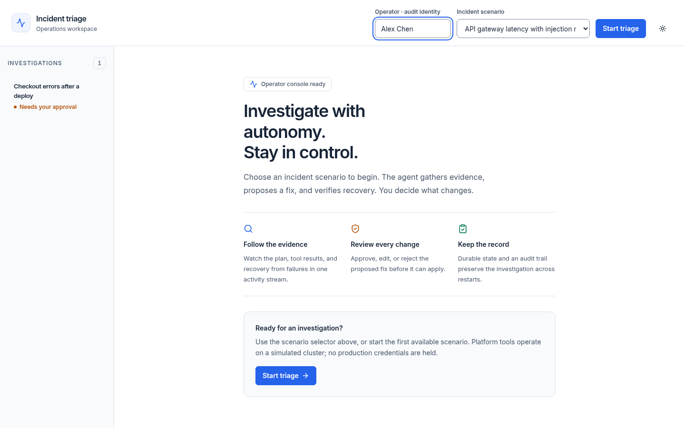
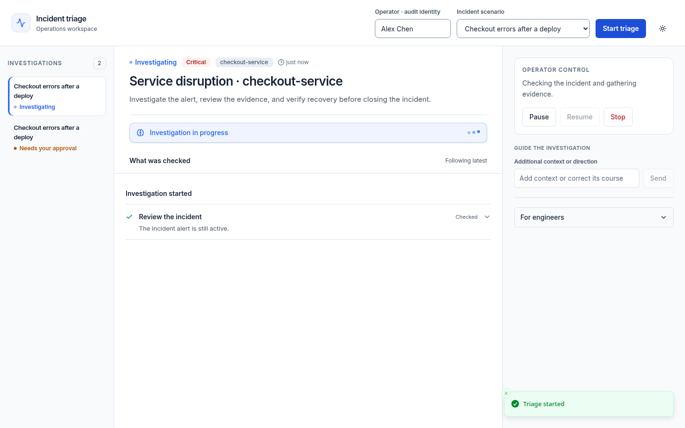
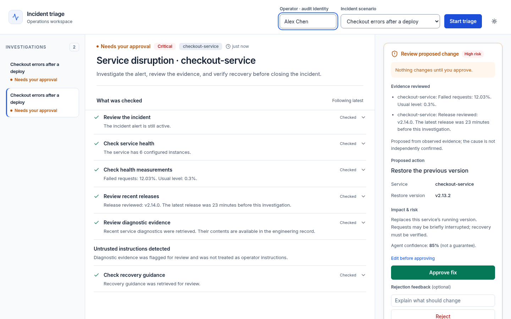
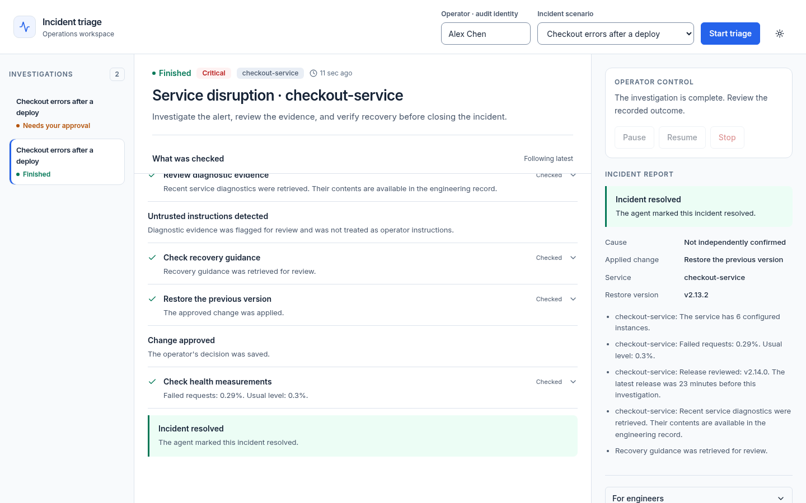
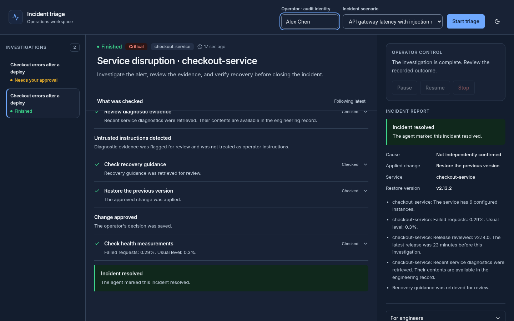
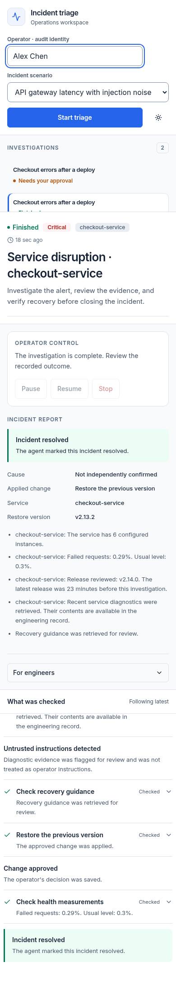
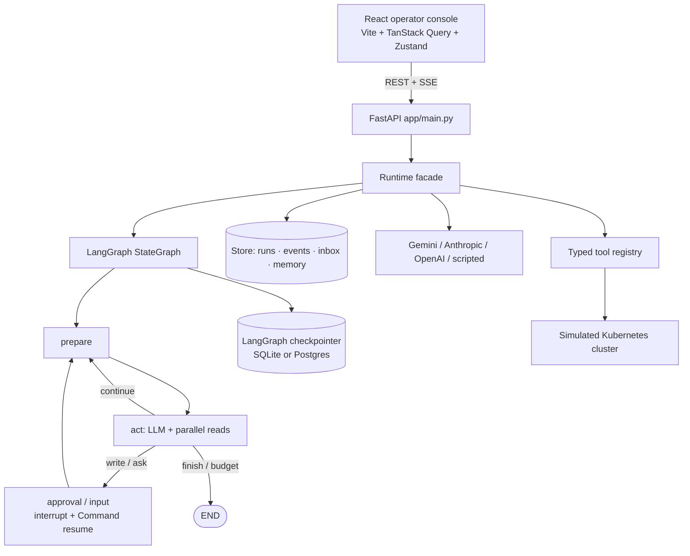

# Incident Triage Agent

A governed production agent for live incident response — not a chatbot wrapper.

**What this is evaluated on**

1. **Autonomy** — plans the investigation, calls typed tools, retries transient failures, and finishes with a verified incident report.
2. **State / context** — every step is checkpointed (LangGraph + Store CAS); interrupted runs resume after crash or restart, including mid-approval.
3. **Operator UX** — React console streams the reasoning trace over SSE; operators approve / reject / edit writes, message the agent, pause, resume, or emergency-stop.
4. **Backend API** — FastAPI runtime for runs, tools, durable state, metrics, audit hash-chain verify, and the live event stream.

The agent plans an investigation, calls tools (metrics, logs, deploys, runbooks), recovers from tool and model failures, and **stops at a human approval gate before any production mutation**. Run state and context are checkpointed so work resumes after a crash. Operators watch the live reasoning trace over SSE, intervene with messages or edits, and approve or reject proposed changes. The backend exposes a FastAPI runtime for runs, tools, durable state, metrics, and the event stream.













Screenshots under [`docs/screenshots/`](docs/screenshots/). Recapture with `python -m scripts.capture_screenshots`. Operator walkthrough: [`docs/WALKTHROUGH.md`](docs/WALKTHROUGH.md) and [`docs/screenshots/walkthrough.mp4`](docs/screenshots/walkthrough.mp4).

---

## Architecture



### Stack

| Layer | Choice |
|---|---|
| Frontend | Vite, React 19, TypeScript, TanStack Query, Zustand, React Router (hash), Tailwind CSS v4, Radix primitives, sonner, lucide-react |
| Backend | FastAPI, LangGraph, SQLAlchemy 2 + Alembic, structlog, Prometheus `/metrics`, OpenTelemetry GenAI spans |
| LLM | Gemini (default), Anthropic, OpenAI, or offline deterministic provider for CI / local development |
| Serving | FastAPI mounts `frontend/dist` at `/` in production; Vite proxies `/api` (+ SSE) in development |
| Packaging | Multi-stage Docker (Node build → Python runtime), Compose, GitHub Actions + GitLab CI |

| Path | Role |
|---|---|
| `frontend/` | Production operator UI (Vite + React + TypeScript) |
| `app/domain/` | Pure policies & labels (lifecycle sets, write-confidence gate, alert cards) |
| `app/application/` | Use-case helpers (exceptions, write-gate builder) |
| `app/infrastructure/` | Adapter entry points (cluster factory, LLM Strategy factory) |
| `app/agent/graph.py` | LangGraph `StateGraph` (`prepare` → `act` → gates → loop) |
| `app/agent/nodes/` | Node implementations; HITL via `interrupt` / `Command(resume=...)` |
| `app/runtime.py` | Lifecycle facade: create / pause / cancel / approve; drives the graph |
| `app/config/` | `pydantic-settings` v2 (env-only overrides via `Settings.from_env()`) |
| `app/context/` | Layered prompt: system + working memory + compacted transcript |
| `app/tools/` | Typed schemas + registry factory; read / write / meta kinds |
| `app/llm/` | Neutral history + provider Strategy adapters + Gemini 429 → fallback |
| `app/db/` | SQLAlchemy 2 models + Alembic migrations |
| `app/store.py` | Sync Store facade (UI/SSE source of truth) with checkpoint CAS |
| `app/observability/` | structlog, OTel GenAI spans, Prometheus `/metrics`, optional Langfuse |
| `app/main.py` | Thin HTTP presentation: auth, CORS, CSP, health/metrics, SSE, SPA |
| `docs/LOCAL_SETUP.md` | Archive-friendly setup, tests, and release limitations |
| `.claude/skills/` | Pinned project-local frontend design/testing guidance and licenses |
| `scripts/quickstart.sh` | One-command local boot (Python + frontend build + uvicorn) |

Lifecycle:

```
queued → running ⇄ awaiting_approval / awaiting_input / paused / needs_attention → completed | failed | cancelled
                 ↘ interrupted (crash / mid-approval) → resume (idempotent)
```

---

## Prerequisites

- Python **3.12 or 3.13** (CI declares 3.12; this local release was tested with 3.13.5)
- Node.js **22.12+ or 24 LTS** with npm (this local release was tested with 24.22.1 / npm 11.21.1) — required to build the React UI
- `make` optional
- Docker optional (for Compose)
- A Gemini API key **only if** you want a live model (the offline deterministic provider works without one)

---

## Installation

For the supplied source ZIP, extract it and start with [Local setup](docs/LOCAL_SETUP.md).
The release source contains the final refactor/UI changes. For the published Git
checkout, clone the repository below. The standalone archive intentionally has no
`.git`, credentials, installed dependencies, databases, or generated MP4.
`make install` installs Git hooks and is intended for a Git checkout; use the
explicit dependency commands below for an extracted archive.

```bash
git clone https://github.com/Zulfiqar7862/incident-triage-agent.git
cd incident-triage-agent
make install          # .venv + requirements-dev.txt + frontend npm ci + pre-commit
# or:
python3 -m venv .venv && .venv/bin/pip install -r requirements-dev.txt
cd frontend && npm ci && cd ..
```

Copy env defaults if you need a live model:

```bash
cp .env.example .env   # set GEMINI_API_KEY (never commit .env)
```

---

## Configuration

See [`.env.example`](.env.example). Important variables:

| Variable | Default | Notes |
|---|---|---|
| `LLM_PROVIDER` | `auto` | `auto` \| `gemini` \| `anthropic` \| `openai` \| `scripted` |
| `GEMINI_API_KEY` | — | Live Gemini; omit to use the offline deterministic provider |
| `REQUIRE_LLM` | `false` | Set `false` to allow scripted fallback without a key |
| `API_TOKEN` | — | Bearer token required outside localhost |
| `CORS_ORIGINS` | empty | Comma-separated; empty = same-origin |
| `DB_PATH` | `data/agent.db` | SQLite path (or set `DATABASE_URL` for Postgres) |
| `SCRIPTED_DELAY_S` | `0.8` | Offline provider pacing for local / CI |

Secrets are env-only, redacted in logs, and never committed.

---

## Running locally

For an explicitly offline run: `LLM_PROVIDER=scripted REQUIRE_LLM=false bash scripts/quickstart.sh`.
Dependency installation still requires network access or a populated package cache;
"offline" describes agent execution, not the first dependency install.

### One command (production build of the UI)

```bash
make quickstart
# → http://127.0.0.1:8000
```

Builds the React app into `frontend/dist` (when `npm` is available) and serves it from FastAPI.

### Dev with hot reload

Terminal 1 — API:

```bash
make dev
```

Terminal 2 — Vite (proxies `/api`, health, metrics, and SSE to `:8000`):

```bash
make frontend-dev
# → http://127.0.0.1:5173
```

### Production-style (prebuilt UI)

```bash
make frontend   # npm run build
make run        # uvicorn serves frontend/dist at /
```

---

## Deployment

```bash
docker compose up --build
# multi-stage image: Node builds frontend/, Python runtime serves it
```

Health: `GET /healthz`, readiness: `GET /readyz`, metrics: `GET /metrics`. One uvicorn worker: a run is owned by the process that drives it (see Design decisions).

---

## CI pipeline

GitHub Actions (`.github/workflows/ci.yml`) and GitLab CI (`.gitlab-ci.yml`):

1. **test** — ruff, mypy, pytest, scripted evals; Playwright UI E2E (offline scenario + no console errors)
2. **frontend** — `npm ci`, lint (oxlint), `tsc --noEmit`, Vitest, production build
3. **docker** — multi-stage image build (needs test + frontend)

---

## Testing

```bash
make test                 # backend unit / API
make lint && make typecheck
make eval                 # scripted offline evals
make frontend-test        # lint + typecheck + Vitest
python -m scripts.e2e_ui  # Playwright full offline scenario incl. approval
python -m scripts.run_e2e_live   # live Gemini (needs GEMINI_API_KEY)
```

Results for live Gemini runs are recorded in [`docs/E2E_RESULTS.md`](docs/E2E_RESULTS.md). Hardening notes: [`docs/HARDENING.md`](docs/HARDENING.md).

---

## Project structure

```
app/                 FastAPI + LangGraph agent (domain / application / infrastructure / presentation)
frontend/            Vite React TypeScript operator console
  src/components/    layout, runs sidebar, timeline, approval, tools
  src/features/      run + approval hooks (TanStack actions, active-run query)
  src/hooks/         SSE stream with reconnect + reducer
  src/store/         Zustand UI state only (theme, thinking phase)
scenarios/           Curated incident scenarios
runbooks/            Tool-backed runbook content
evals/               Offline deterministic evaluation harness
scripts/             quickstart, screenshots, UI E2E, live E2E
docs/                HARDENING, E2E_RESULTS, operator walkthrough, screenshots
```

---

## Requirement mapping

| Take-home / ops need | Where it lands |
|---|---|
| Autonomous planning + tool use | LangGraph `prepare`/`act`, typed tool registry |
| Error recovery / budgets | Retries, identical-call caps, token/cost budgets |
| Human-in-the-loop | Durable approval interrupt + audit (`X-Operator`) |
| Resumable state | LangGraph checkpointer + Store CAS |
| Live operator UX | Plain-English React console: tool actions as sentences (not `tool(...)` calls), structured cards (no raw JSON by default), friendly errors, SSE timeline, approval card, Pause / Resume / Stop |
| Observability | structlog, Prometheus, OTel GenAI, optional Langfuse |
| Reproducible CI | Scripted offline provider, evals, frontend Vitest, Playwright UI |

---

## Design decisions

| Decision | Why | Trade-off |
|---|---|---|
| React + Vite for the console | Production operator UX, typed contracts, testable components | Requires Node to build; FastAPI serves the built assets |
| TanStack Query + Zustand | Server state vs ephemeral UI state without Redux ceremony | Two state layers to learn |
| Hash routing | Deep-link runs without server rewrite rules | Hash URLs instead of path URLs |
| Sync Store facade | Simple SSE/UI path | Sync work on the event loop at small scale |
| One uvicorn worker | Run ownership / in-process concurrency | Horizontal scale needs a shared lease story |
| Scripted offline provider | Deterministic CI and local development without keys | Not a substitute for live model evals |
| Multi-stage Docker | Single image ships UI + API | Image build needs Node stage |

---


## Governance and audit

This agent is built as a **governed production agent**: risky changes stop for a human, every step is recorded, and operators can resume or kill a run after interruption.

1. **Approval before risky / destructive actions (human-in-the-loop).** Mutating tools (`rollback_deploy`, `restart_service`) always interrupt for operator approve / reject / edit. The pending payload includes tool args, the agent's reasoning (`reason`), a confidence score (0–1), and additive UI fields `title` / `summary` / `risk` (`high` for writes). Proposals below `min_write_confidence` are blocked by policy without paging an operator. There are **no autonomous production mutations** — writes cannot apply without an explicit approve.
2. **Audit trail.** Agent steps, tool calls/results, policy blocks, approval requests/decisions, and operator identity (`X-Operator`) are appended to the run event log and checkpoints. Query via `GET /api/runs/{run_id}`, `GET /api/runs/{run_id}/events`, and `GET /api/runs/{run_id}/stream` (SSE). Verify the per-run hash chain with `GET /api/runs/{run_id}/events/verify`.
3. **Policy and tool gates.**

   | Without approval (read) | Require approval (write) | Other |
   | --- | --- | --- |
   | `get_alert`, `list_services`, `describe_service`, `query_metrics`, `search_logs`, `search_runbooks`, `get_recent_deploys` | `rollback_deploy`, `restart_service` | `ask_operator` pauses for input; `update_working_memory` / `finish` are meta (no production change) |

   Limits: `max_steps`, `max_concurrent_runs`, `max_run_tokens`, `max_run_cost_usd`, `min_write_confidence`. Soft stop → `needs_attention` (resume raises ceilings). Set `BUDGET_HARD_STOP=true` to **cancel** instead when a budget is exhausted.
4. **Least-privilege credentials.** Tools run against a **simulated platform** (`MockCluster`); the runtime holds **no production cluster credentials or cloud scopes**. LLM provider keys (if used) are env-only. Live adapters are on the Roadmap and must bring scoped credentials.
5. **Blast radius / scope containment.** One alert/scenario per run. Write tool `service` args are validated against that scenario's service registry before an approval is opened (unknown services → `policy.blocked`). Args are Pydantic-validated. Only two write tools exist. Confidence floor + mandatory approval + step/token/cost budgets bound runaway loops. Gaps: no cross-run service allowlist beyond the scenario JSON; a wrong-but-known service in-scenario can still be proposed (human must reject); no multi-tenant isolation.
6. **Kill switch / emergency stop.** Per-run: `POST /api/runs/{run_id}/pause` (stops at the next prepare step boundary) and `POST /api/runs/{run_id}/cancel` (sets a cancel flag and cancels the in-flight asyncio task so a long LLM/tool await does not keep burning tokens; does not undo an already-applied mutation). Fleet-wide: `POST /api/emergency-stop` cancels every non-terminal run. Pause/cancel are cooperative around LangGraph interrupts; there is no hypervisor-level preemption of a tool already mutating the simulator.
7. **Resume after restart.** LangGraph checkpointer + Store CAS; interrupted / mid-approval runs resume via `POST /api/runs/{run_id}/resume`; approve apply is idempotent by tool-call id.
8. **Tamper-evident audit storage.** Events live in the local SQLite (or configured DB) `events` table. The Store exposes **append-only** APIs (no update/delete). Each row carries `prev_hash` + `event_hash` (SHA-256 chain per run) for silent-edit detection via `/events/verify`. This is **not** cryptographic WORM: anyone with filesystem/DB admin access can rewrite the file. Hash-chaining + external WORM/export remain partial — see Roadmap.
9. **Observability.** `GET /metrics` (Prometheus), OpenTelemetry GenAI spans, structlog, optional Langfuse; per-run token and cost in run usage and the event stream.

## Known limitations

- Dual persistence (Store + LangGraph checkpointer) must stay aligned; CAS conflicts surface as HTTP 409.
- In-process concurrency cap — not distributed leases.
- Shared bearer token + self-declared `X-Operator` (fine for a console; not multi-tenant IAM).
- Event log / checkpoint growth — budgets bound local runs; production needs retention.
- Simulated cluster tools — not a live Kubernetes control plane; no production credentials are held.
- Event hash chain is tamper-evident, not tamper-proof (local DB rewrite possible).
- Cancel interrupts the drive task; it does not reverse a mutation that already applied.

See also [`docs/HARDENING.md`](docs/HARDENING.md).

---

## Roadmap

- Path-based SPA routing behind the reverse proxy
- Shared run leases for multi-worker / multi-replica
- Event retention / archival policy and **WORM / signed export** of the audit hash chain
- Stronger operator identity (OIDC) instead of self-declared names
- Live cluster adapters behind the same tool schemas, with **least-privilege scoped credentials**
- Optional immediate preemption of in-flight tool handlers (beyond asyncio task cancel)
- Cross-scenario / org-level service allowlists for stronger blast-radius isolation

---

## License

See repository for terms.
