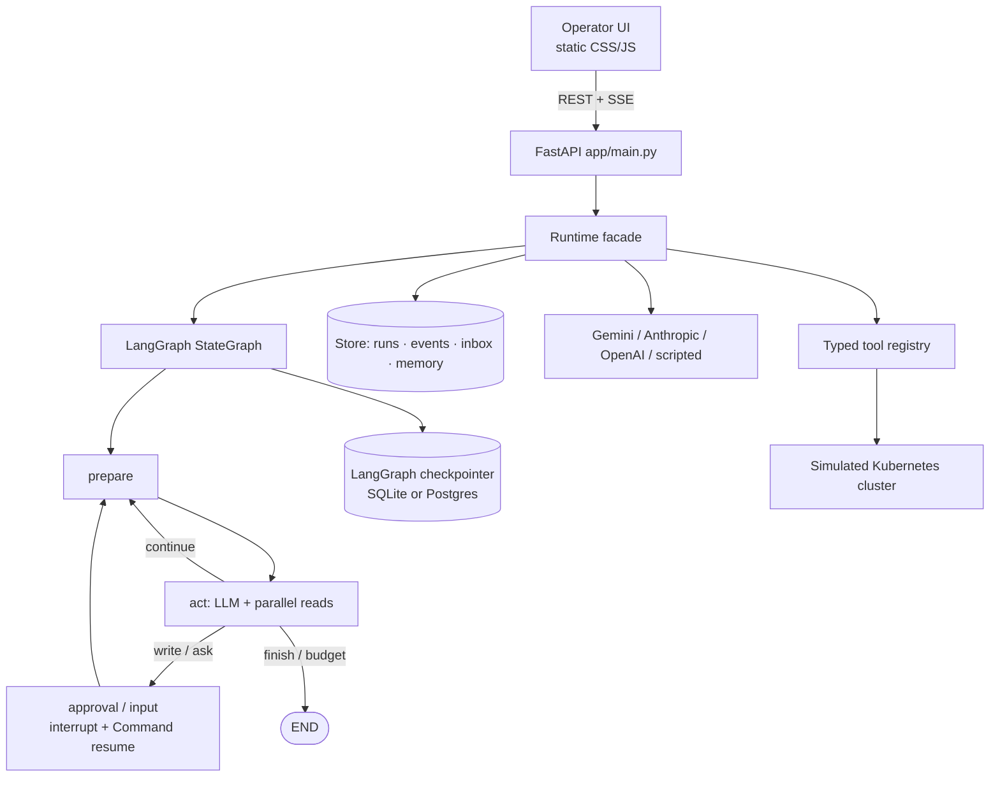

# Incident triage agent

**Pitch.** Paste a production alert. The agent plans an investigation, calls tools (metrics, logs, deploys, runbooks), updates structured working memory, and proposes a fix. **Every production change stops at a durable human approval gate** with a confidence score — low confidence is bounced back to the agent instead of paging a person. Operators watch the live reasoning trace over SSE, can edit / reject / redirect, and can resume after a crash from the last checkpoint.

Built for an Intuitive Technology Partners *Senior Software Engineer – AI* take-home: genuine autonomy (planning, tool use, error recovery, HITL), resumable state, web UI + backend APIs, and a one-command local setup.


Screenshots under [`docs/screenshots/`](docs/screenshots/) (desktop light/dark, mobile, approval → resolved). Recapture with `python -m scripts.capture_screenshots`.

---

## Architecture



| Path | Role |
|---|---|
| `app/agent/graph.py` | LangGraph `StateGraph` (`prepare` → `act` → gates → loop) |
| `app/agent/nodes/` | Node implementations; HITL via `interrupt` / `Command(resume=...)` |
| `app/runtime.py` | Lifecycle facade: create / pause / cancel / approve; drives the graph |
| `app/config/` | `pydantic-settings` v2 (env-only overrides via `Settings.from_env()`) |
| `app/context/` | Layered prompt: system + working memory + compacted transcript |
| `app/tools/` | Typed schemas; read / write / meta kinds |
| `app/llm/` | Neutral history + provider adapters + Gemini 429 → fallback model |
| `app/db/` | SQLAlchemy 2 models + Alembic migrations |
| `app/store.py` | Sync Store facade (UI/SSE source of truth) with checkpoint CAS |
| `app/observability/` | structlog, OTel GenAI spans, Prometheus `/metrics`, optional Langfuse |
| `app/main.py` | HTTP API, auth, CORS, CSP, health/metrics, SSE |
| `static/` | Operator UI (no build step): `index.html` + `css/app.css` + `js/app.js` |
| `scripts/quickstart.sh` | One-command local boot |

Lifecycle:

```
queued → running ⇄ awaiting_approval / awaiting_input / paused / needs_attention → completed | failed | cancelled
                 ↘ interrupted (crash / mid-approval) → resume (idempotent)
```

---

## Prerequisites

- Python **3.11+** (3.12 recommended; CI uses 3.12)
- `make` optional
- Docker optional (for Compose)
- A Gemini API key **only if** you want a live model (offline scripted policy works without one)

---

## Installation

```bash
git clone https://github.com/Zulfiqar7862/incident-triage-agent.git
cd incident-triage-agent
make install          # creates .venv, installs requirements-dev.txt, hooks pre-commit
# or:
python3 -m venv .venv && .venv/bin/pip install -r requirements-dev.txt
```

---

## Configuration

Copy the example env file and edit:

```bash
cp .env.example .env
```

`.env` is gitignored. **Never commit API keys.** The app reads env vars (and `.env` via `Settings.from_env()` / `load_dotenv()`); nothing is hardcoded.

### How to get a Gemini key

1. Open [Google AI Studio](https://aistudio.google.com/apikey) and create an API key.
2. Put it in `.env` as `GEMINI_API_KEY=...` (no quotes needed).
3. Optional: `make check-llm` to verify a two-step tool-calling round-trip.
4. Restart the server.

Free-tier `gemini-3.5-flash` often returns **429**. Prefer `GEMINI_MODEL=gemini-3.5-flash-lite`, or keep flash as primary — the runtime automatically falls back to `GEMINI_FALLBACK_MODEL` (default `gemini-3.5-flash-lite`) on quota/429.

### Environment variables

| Variable | Default | Purpose |
|---|---|---|
| `GEMINI_API_KEY` | _(empty)_ | Google AI key (also accepts `GOOGLE_API_KEY`) |
| `GEMINI_MODEL` | `gemini-3.5-flash` | Primary Gemini model id |
| `GEMINI_FALLBACK_MODEL` | `gemini-3.5-flash-lite` | Used after primary 429/quota |
| `ANTHROPIC_API_KEY` | | Anthropic key if using that provider |
| `OPENAI_API_KEY` | | OpenAI key if using that provider |
| `LLM_PROVIDER` | `auto` | `auto` \| `gemini` \| `anthropic` \| `openai` \| `scripted` |
| `REQUIRE_LLM` | `false` | Fail startup instead of falling back to scripted |
| `API_TOKEN` | _(empty)_ | Bearer token (≥16 chars). **Set before exposing beyond localhost** |
| `CORS_ORIGINS` | _(empty)_ | Comma-separated browser origins; empty = same-origin only |
| `MAX_REQUEST_BYTES` | `1048576` | Reject larger request bodies with 413 |
| `DB_PATH` | `data/agent.db` | SQLite path for the Store |
| `DATABASE_URL` | _(empty)_ | SQLAlchemy URL; Postgres → `postgresql+asyncpg://...` |
| `CHECKPOINT_DB_PATH` | beside `DB_PATH` | LangGraph checkpointer SQLite path |
| `MAX_STEPS` | `25` | Hard step budget per run |
| `MAX_RUN_TOKENS` | `400000` | Token budget |
| `MAX_RUN_COST_USD` | `1.0` | Cost budget (`0` disables) |
| `MAX_CONCURRENT_RUNS` | `10` | In-process concurrency cap |
| `CONTEXT_BUDGET_TOKENS` | `24000` | Prompt rebuild budget |
| `TOOL_OUTPUT_MAX_CHARS` | `6000` | Truncate tool output before the model sees it |
| `MIN_WRITE_CONFIDENCE` | `0.5` | Below this, writes are blocked (not paged) |
| `MAX_IDENTICAL_TOOL_CALLS` | `3` | Loop guard |
| `BUDGET_ALERT_RATIO` | `0.8` | Emit `budget.alert` before hard stop |
| `MEMORY_TTL_DAYS` | `30` | Long-term memory recall window |
| `COST_IN_PER_MTOK` / `COST_OUT_PER_MTOK` | `0.5` / `3.0` | Cost telemetry prices |
| `LLM_TIMEOUT_S` | `120` | Provider HTTP timeout |
| `LLM_MAX_ATTEMPTS` | `4` | Provider retry attempts |
| `TOOL_MAX_ATTEMPTS` / `TOOL_TIMEOUT_S` | `3` / `10` | Tool retry / timeout |
| `LOG_FORMAT` | `text` | `text` \| `json` |
| `LOG_LEVEL` | `INFO` | |
| `OTLP_ENDPOINT` | _(empty)_ | e.g. `http://localhost:4318` — empty disables export |
| `LANGFUSE_PUBLIC_KEY` / `LANGFUSE_SECRET_KEY` | | Optional Langfuse |
| `LANGFUSE_HOST` | `https://cloud.langfuse.com` | |
| `SCRIPTED_DELAY_S` | `0.8` | Offline demo pacing |

---

## How to run

### Quickstart (≈2 minutes, offline)

```bash
bash scripts/quickstart.sh   # venv + deps + http://127.0.0.1:8000
```

No `.env` → **scripted offline policy** (UI, APIs, tests, CI all work).

### Manual

```bash
make run     # uvicorn on :8000
make dev     # with --reload
```

### Docker

```bash
cp .env.example .env   # set GEMINI_API_KEY and API_TOKEN
make docker            # docker compose up --build
```

Compose builds a non-root image with a healthcheck, persists SQLite on a volume, and binds to localhost. Put TLS in front before exposing it.

### Using the UI

1. Open http://127.0.0.1:8000
2. Enter your name (audit identity for approvals)
3. Pick a scenario → **Start triage**
4. Watch the live trace (plan, hypotheses, tool calls, retries)
5. When an approval card appears: edit args if needed → **Approve and run**, or **Reject** with feedback
6. Use Pause / Resume / Cancel; **Inspect context** shows the exact next model prompt
7. After a server restart, interrupted runs can be **Resumed** from the last checkpoint

If `API_TOKEN` is set, the UI prompts once and stores the token in `sessionStorage` (SSE uses `?token=`).

Interactive OpenAPI: [/docs](http://127.0.0.1:8000/docs).

---

## How to test

```bash
make test                                          # unit + integration (no key)
make typecheck                                     # mypy -p app (enforced in CI)
make lint
.venv/bin/python -m evals.run_evals --provider scripted   # golden set offline
make check-llm                                     # live Gemini connectivity (needs key)
GEMINI_MODEL=gemini-3.5-flash-lite python -m scripts.run_e2e_live
# Opt-in pytest (skipped in CI without a key):
pytest -m live -q
```

Live E2E results are written to [`docs/E2E_RESULTS.md`](docs/E2E_RESULTS.md) (no secrets).

CI (`.github/workflows/ci.yml`): ruff → **mypy (required)** → pytest → scripted evals → Docker build.

---

## Project structure

```
app/                 FastAPI app, LangGraph agent, tools, LLM, Store, observability
static/              Operator UI (no build)
scenarios/           Incident definitions (JSON)
runbooks/            Keyword-retrieved ops notes
evals/               Golden-set harness + results
tests/               Unit / integration / opt-in live
scripts/             quickstart, check_llm, run_e2e_live, capture_screenshots
docs/                AI_TRANSCRIPT, E2E_RESULTS, screenshots
.github/workflows/   GitHub Actions CI
```

---

## Mapping to assignment requirements

| Requirement | Where |
|---|---|
| AI agent automates a platform-engineering task end to end | Incident triage over simulated K8s (`app/mock_env.py`, scenarios) |
| Web UI | `static/` served by FastAPI `/` |
| Backend APIs | `app/main.py` REST + SSE |
| Local dev setup | `scripts/quickstart.sh`, `Makefile`, `Dockerfile` / Compose |
| Planning | `update_working_memory` plan/hypotheses; prepare→act loop |
| Tool use | Typed tools in `app/tools/`; parallel reads with retry |
| Error recovery | tenacity + custom retries; tool/LLM transient vs permanent; resume after failure |
| Human-in-the-loop approval | LangGraph `interrupt` + approve/reject/edit APIs + UI cards |
| Resumable state | LangGraph checkpointer + Store checkpoints; `interrupted` → resume |
| Public GitHub repo + README | this repository |
| Meaningful git history | conventional commits on `main` |
| AI interaction log | [`docs/AI_TRANSCRIPT.md`](docs/AI_TRANSCRIPT.md) (owner-pasted; not fabricated) |

---

## Design decisions and tradeoffs

| Choice | Why | Tradeoff |
|---|---|---|
| **LangGraph StateGraph** | Real `interrupt` / `Command(resume)`, durable threads | Dual persistence (graph checkpointer + Store event log) |
| **Runtime facade** | Keeps REST/SSE/UI stable while orchestration evolves | Extra layer vs calling the graph from handlers directly |
| **pydantic v2 + settings** | One schema stack for Settings, tools, HTTP | Tests must use `Settings(...)` / `from_env()` carefully |
| **Sync Store + optional async SQLAlchemy** | Simple UI path; Postgres-ready models/migrations | Sync facade on the event loop for small demos |
| **Gemini thought-signature replay** | Required for multi-step Gemini tool loops | Provider-specific `raw` blob in history |
| **Gemini fallback model** | Free-tier flash 429s should not crash a run | Fallback may be a weaker model |
| **No UI build step** | Quickstart + Docker stay simple | Hand-structured CSS/JS instead of React |
| **Scripted offline policy** | CI/demo without keys | Not a substitute for live model evals |
| **DeepEval not adopted** | Heavy transitive deps; golden harness + judge enough | Less “eval platform” branding |

**Confidence routing.** Writes below `MIN_WRITE_CONFIDENCE` never page a human.

**Structural injection defence.** Log lines cannot execute writes; scenarios plant injection strings and evals fail on forbidden targets.

**Observability.** Append-only event log = UI trace = ops evidence. Optional OTLP + Langfuse; Prometheus `/metrics`.

---

## The three scenarios

1. **Checkout errors after a deploy** (`db-pool-regression`) — pool sized 50→5; flaky logs; prompt-injection noise.
2. **Payment errors with a misleading deploy** (`upstream-oom`) — real cause is upstream OOM; rollback of the leaf service is wrong.
3. **API gateway latency with injection noise** (`cache-oom-injection`) — must not touch billing; restart/rollback of api-gateway is valid.

---

## API (summary)

Auth when `API_TOKEN` is set: `Authorization: Bearer …` (SSE may use `?token=`). Optional `X-Operator` for the audit log.

| Method | Path | Notes |
|---|---|---|
| GET | `/healthz` `/readyz` `/metrics` | Unauthenticated probes |
| GET | `/api/health` `/api/scenarios` `/api/tools` | |
| POST | `/api/runs` | Start (`429` if too busy) |
| GET | `/api/runs` `/api/runs/{id}` | |
| GET | `/api/runs/{id}/stream` | SSE (+ `Last-Event-ID`) |
| POST | `/api/runs/{id}/approve\|reject\|message\|pause\|resume\|cancel` | Mutating |

Errors: `401` auth, `404` missing, `409` bad state / checkpoint CAS, `413` body too large, `422` validation, `429` busy/rate.

Security headers: `X-Content-Type-Options`, `X-Frame-Options`, `Referrer-Policy`, `Permissions-Policy`, `Content-Security-Policy`. Configurable CORS.

---

## Known limitations (honest)

- **Dual persistence** (Store + LangGraph checkpointer) — two concepts to operate; same deploy story.
- **Sync Store / sync approve path** on the asyncio loop — fine for take-home concurrency; production would push Store IO to threads/workers.
- **In-process concurrency limit** — not a distributed lease; one process per DB.
- **Shared bearer auth** — not SSO/RBAC; `X-Operator` is self-declared.
- **Event log / checkpoint growth** — budgets bound demos; production needs retention.
- **Simulated cluster** — deliberate for a public take-home; `mock_env.py` is the integration seam.
- **Keyword runbooks** — not embeddings.
- **Token budgeting** — ~4 chars/token estimate, not a real tokenizer.

### Not built (on purpose)

SSO/RBAC, multi-agent supervisor, vector RAG, real K8s/Prom/Loki credentials, multi-worker leases, full OpenTelemetry auto-instrumentation, DeepEval CI.

---

## How this was built

AI pair-programming was used (Cursor / Grok Bot). Notes live in [`docs/AI_TRANSCRIPT.md`](docs/AI_TRANSCRIPT.md) — paste your original build chats there; do not fabricate a transcript. **Git history** is the source of truth for how the solution evolved.
