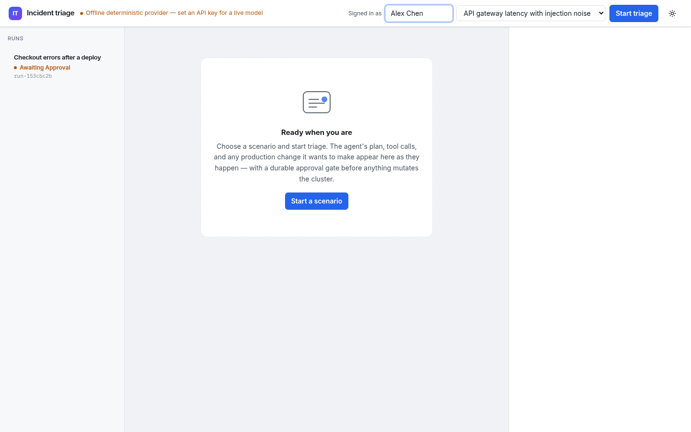
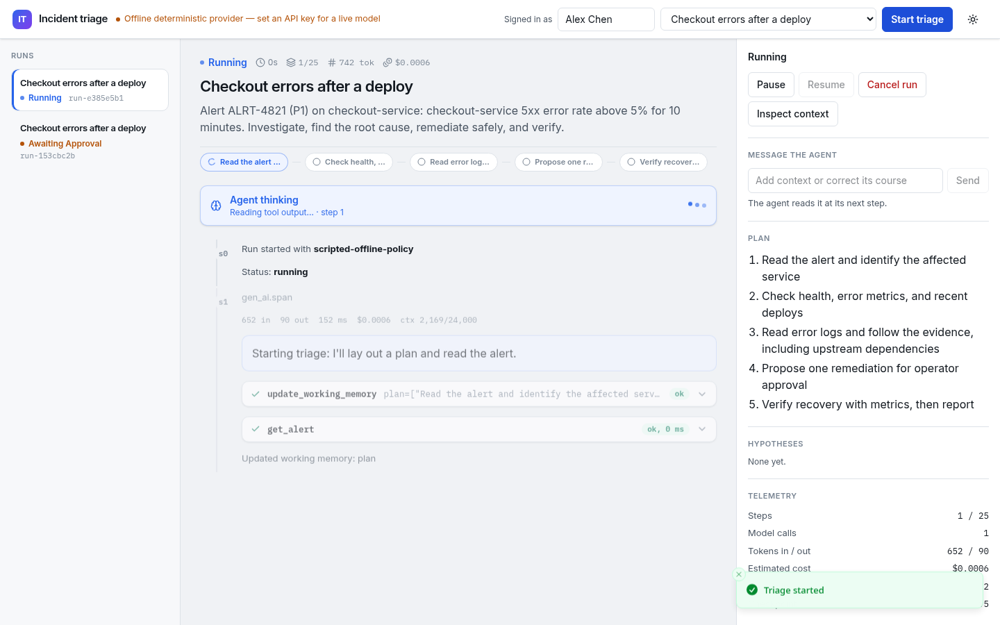
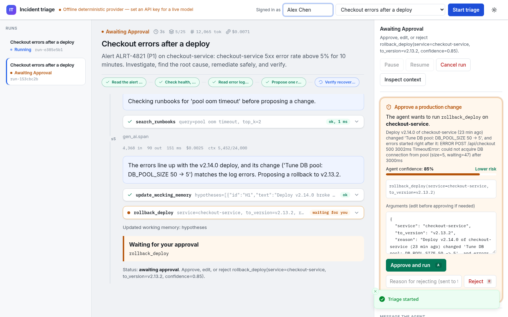
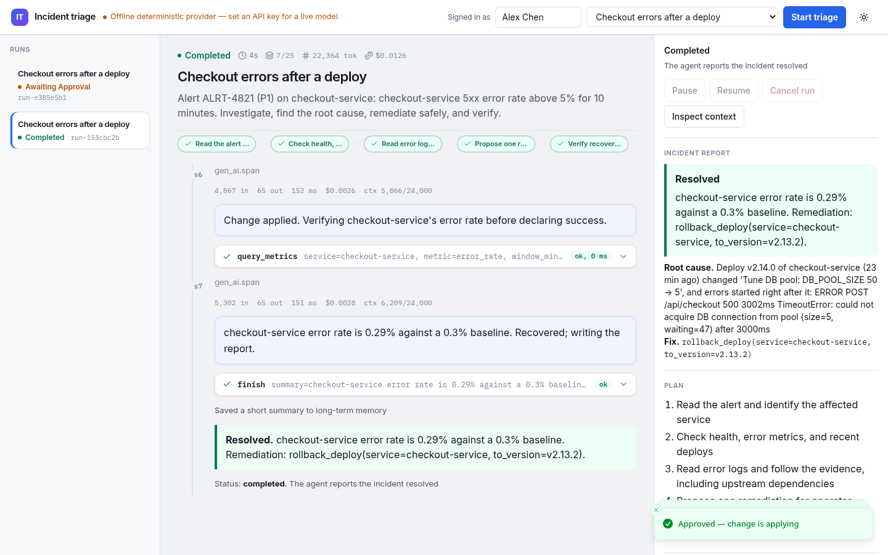
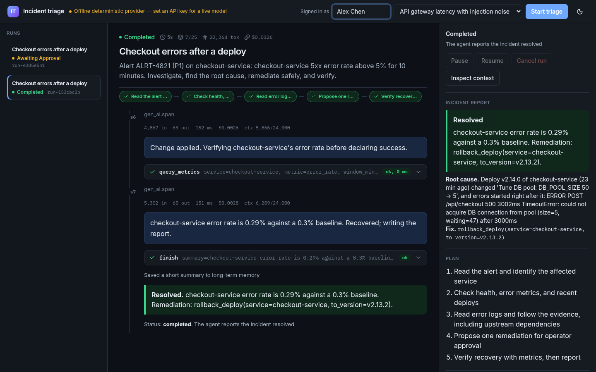
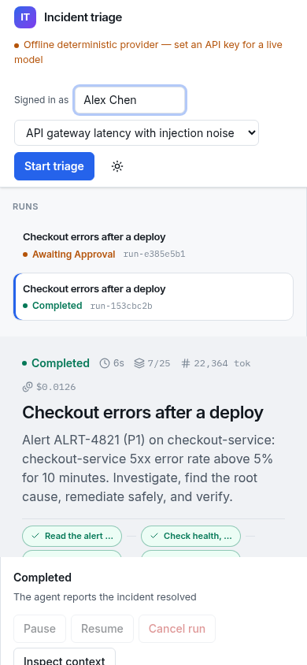
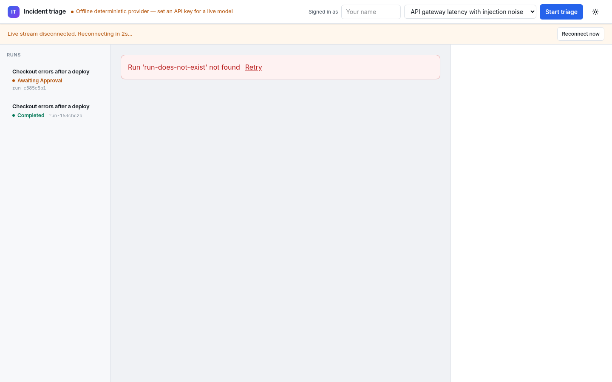

# Operator walkthrough

End-to-end tour of the React operator console against the **offline deterministic provider** (no API key). Recording: [`screenshots/walkthrough.mp4`](screenshots/walkthrough.mp4). Recreate with:

```bash
make frontend
.venv/bin/python -m scripts.record_walkthrough
.venv/bin/python -m scripts.capture_screenshots
```

## Scenario

**db-pool-regression** — checkout-service elevated 5xx after a deploy that shrank the DB pool. The agent investigates metrics/logs/deploys, then requests approval to roll back.

## Steps

1. **Empty console** — operator name set; scenario selected; no active run.
   

2. **Running / thinking** — live SSE timeline, step rail, thinking indicator, tool cards.
   

3. **Approval gate** — confidence meter, args editor with diff, Approve (`A`) / Reject (`R`).
   

4. **Resolved** — outcome card, token/cost counters, audit trail for the approved write.
   

5. **Dark mode & mobile** — theme toggle; responsive layout under ~720px.
   
   

6. **Error / toast** — missing run surfaces an inline error; approve/reject confirmations use sonner toasts.
   

## What to watch for in the MP4

- Scenario start navigates to `/#/runs/<id>`
- Streaming tool cards expand with syntax-highlighted args/output
- Approval card blocks the write until Approve
- Post-approve continuation finishes with a resolved outcome
