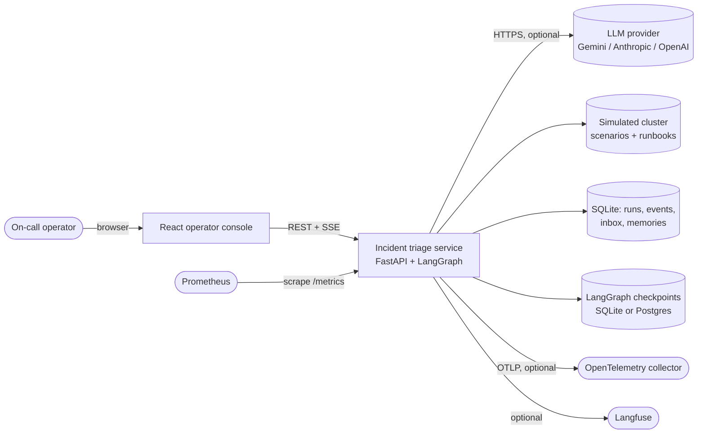
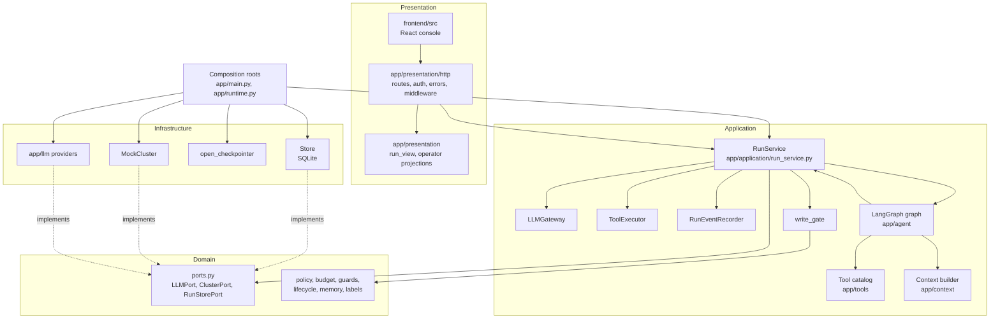
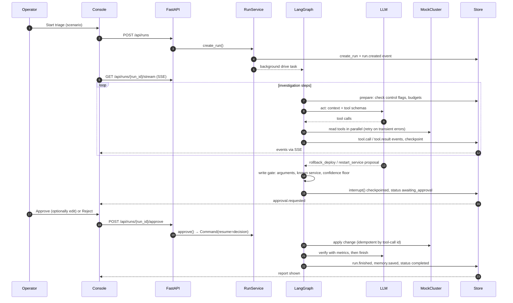
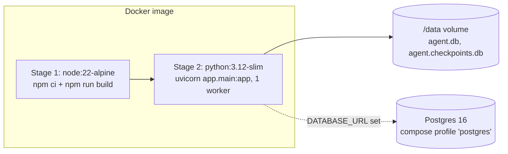

# High-Level Design: Incident Triage Agent

Companion documents: [Low-Level Design](LLD.md) · [Architecture review guide](ARCHITECTURE_REVIEW.md) · [PyCharm demo](PYCHARM_DEMO.md)

## 1. Purpose and scope

The service is an autonomous agent for one platform-engineering task: triage a
production alert end to end. For each run it plans an investigation, calls
typed tools (alert, services, metrics, logs, deploy history, runbooks), forms
hypotheses, proposes a remediation, stops for a human decision before any
change, applies the approved change, verifies recovery, and writes an incident
report.

**Scope boundary (stated plainly):** every platform tool runs against a
**simulated cluster** (`MockCluster`, [`app/infrastructure/mock_cluster.py`](../app/infrastructure/mock_cluster.py))
driven by scenario files in [`scenarios/`](../scenarios). This holds even when a
live model (Gemini, Anthropic, OpenAI) is configured. The service holds no
Kubernetes or cloud credentials. A live platform adapter is roadmap work; the
`ClusterPort` interface ([`app/domain/ports.py`](../app/domain/ports.py)) is the
seam where it would plug in.

The design targets four qualities:

| Quality | How the design addresses it |
| --- | --- |
| Autonomy | LangGraph loop (`prepare` → `act` → gates) with tool retries, LLM retries, loop guard, budgets |
| Durable state | Every step checkpointed (Store CAS row + LangGraph checkpointer); restart marks runs `interrupted`; resume continues |
| Operator UX | React console streams events over SSE; approve / edit / reject, message, pause, resume, stop |
| Backend API | FastAPI runtime for runs, tools, state, events, audit verification, metrics |

## 2. System context

Without an API key the service selects the deterministic `ScriptedPolicy`
([`app/llm/scripted.py`](../app/llm/scripted.py)), so the whole system runs
offline for local evaluation and CI.

## 3. Components

| Component | Responsibility | Code |
| --- | --- | --- |
| React console | Run list, live activity, approval card, operator controls, engineer details | [`frontend/src`](../frontend/src) |
| HTTP presentation | Validate requests, authenticate, call one service method, return views | [`app/presentation/http/routes.py`](../app/presentation/http/routes.py) |
| Operator projections | Plain-language `operator` fields added to API payloads; canonical data unchanged | [`app/presentation/operator.py`](../app/presentation/operator.py) |
| RunService | Run lifecycle use cases and the LangGraph drive loop | [`app/application/run_service.py`](../app/application/run_service.py) |
| LangGraph graph | `prepare`, `act`, `approval`, `input` nodes; interrupts for human gates | [`app/agent/graph.py`](../app/agent/graph.py) |
| Tool catalog | Typed argument models, JSON schemas, read/write/meta kinds | [`app/tools/specs.py`](../app/tools/specs.py) |
| Domain | Ports, write-confidence policy, budgets, loop/injection guards, lifecycle sets | [`app/domain/`](../app/domain) |
| Store | Run checkpoints with CAS, hash-chained event log, inbox, long-term memory | [`app/infrastructure/store.py`](../app/infrastructure/store.py) |
| MockCluster | Simulated platform with idempotent write actions | [`app/infrastructure/mock_cluster.py`](../app/infrastructure/mock_cluster.py) |
| LLM providers | Gemini (with quota fallback), Anthropic, OpenAI, scripted | [`app/llm/providers.py`](../app/llm/providers.py) |
| Composition roots | Choose concrete adapters and build the app | [`app/runtime.py`](../app/runtime.py), [`app/main.py`](../app/main.py) |

## 4. End-to-end flow

Rejection follows the same path: the gate records the operator's feedback as
the tool result, the change is not executed, and the agent continues
investigating with that feedback in context.

## 5. Deployment view

| Mode | Command | Notes |
| --- | --- | --- |
| Local, one command | `LLM_PROVIDER=scripted REQUIRE_LLM=false bash scripts/quickstart.sh` | Creates `.venv`, installs, builds `frontend/dist`, serves on `127.0.0.1:8000` |
| Local dev | `make dev` + `make frontend-dev` | Vite on `:5173` proxies `/api` and SSE to `:8000` |
| PyCharm | Shared run configurations in [`.run/`](../.run) | See [PYCHARM_DEMO.md](PYCHARM_DEMO.md) |
| Container | `docker compose up --build` | Multi-stage [`Dockerfile`](../Dockerfile): Node 22 builds the UI, Python 3.12 runtime serves it as an unprivileged user; data on the `/data` volume; healthcheck on `/readyz` |

**Persistence choice.** The Store always uses SQLite at `DB_PATH`
([`app/infrastructure/store.py`](../app/infrastructure/store.py)). When
`DATABASE_URL` points at Postgres, the LangGraph checkpointer switches to
`AsyncPostgresSaver` ([`app/infrastructure/checkpointer.py`](../app/infrastructure/checkpointer.py));
otherwise it uses SQLite at `CHECKPOINT_DB_PATH` (default
`data/agent.checkpoints.db`). SQLAlchemy models and an Alembic migration exist in
[`app/db/`](../app/db) for the same four tables; the running Store creates its
schema itself and does not go through SQLAlchemy.

## 6. Cross-cutting concerns

### State persistence and resume
- Two checkpoints per step: the Store row (`runs.state`, guarded by
  `checkpoint_version` compare-and-set) is the UI and API source of truth; the
  LangGraph checkpointer (thread id = run id) holds the graph position, including
  pending interrupts.
- On startup `RunService.recover()` marks `running`/`queued` runs, and approvals
  that were mid-apply, as `interrupted`. `POST /api/runs/{run_id}/resume` continues
  from the last checkpoint. Write actions are idempotent by tool-call id, so a
  replayed approval does not apply twice.

### Human in the loop and governance
| Control | Mechanism | Code |
| --- | --- | --- |
| Approval gate | Write tools always route to `approval_node`, which calls `interrupt()` | [`app/agent/nodes/gates.py`](../app/agent/nodes/gates.py) |
| Write confidence floor | Proposals below `MIN_WRITE_CONFIDENCE` are returned to the agent without paging a human | [`app/domain/policy.py`](../app/domain/policy.py), [`app/application/write_gate.py`](../app/application/write_gate.py) |
| Scope check | Unknown services are blocked (`policy.blocked`) before an approval opens | [`app/application/write_gate.py`](../app/application/write_gate.py) |
| Edit before approve | Edited arguments are re-validated by the tool's Pydantic model | `RunService.approve` |
| Hash-chained audit | Each event stores `prev_hash` and `event_hash` (SHA-256); `GET /api/runs/{run_id}/events/verify` recomputes the chain | [`app/infrastructure/store.py`](../app/infrastructure/store.py) |
| Pause / cancel | Pause takes effect at the next `prepare` step boundary; cancel also cancels the in-flight task | `RunService.pause`, `RunService.cancel` |
| Emergency stop | `POST /api/emergency-stop` cancels every non-terminal run (API only; no UI button) | `RunService.emergency_stop` |
| Budgets | Step, token, and cost ceilings; soft stop to `needs_attention` (resume raises the ceiling) or, with `BUDGET_HARD_STOP=true`, cancel | [`app/agent/nodes/prepare.py`](../app/agent/nodes/prepare.py) |
| Loop guard | Same tool + arguments `MAX_IDENTICAL_TOOL_CALLS` times → `needs_attention` | [`app/domain/guards.py`](../app/domain/guards.py) |
| Prompt-injection flag | Instruction-like text in tool output is flagged and prefixed as untrusted data | [`app/application/tool_executor.py`](../app/application/tool_executor.py) |

The audit chain is tamper-evident, not tamper-proof: someone with write access
to the database file can rewrite the whole chain.

### Observability
- **Logs:** structlog, text or JSON (`LOG_FORMAT`), with a redaction processor
  for key/token/secret patterns ([`app/observability/logging_setup.py`](../app/observability/logging_setup.py)).
- **Traces:** an OpenTelemetry span per LLM call with GenAI attributes; exported
  over OTLP/HTTP when `OTLP_ENDPOINT` is set ([`app/observability/tracing.py`](../app/observability/tracing.py)).
  Span attributes are also stored as `gen_ai.span` events.
- **Metrics:** Prometheus at `/metrics`: LLM calls, tokens, cost, latency,
  tool calls (by tool and error), approvals, runs by status, events by type ([`app/observability/metrics.py`](../app/observability/metrics.py)).
- **Langfuse:** a client is created when both keys are set. The runtime does not
  yet send generations to it (`trace_generation` exists but is not called).

### Security
- Optional bearer token (`API_TOKEN`, at least 16 characters, compared with
  `hmac.compare_digest`); SSE accepts `?token=` because `EventSource` cannot set
  headers. Probes and `/metrics` stay unauthenticated and carry no run data.
- `X-Operator` is sanitised and recorded in the audit log. It is self-declared,
  not an identity provider.
- Security headers (CSP, `X-Frame-Options: DENY`, `nosniff`, no-referrer),
  request-size limit, CORS off unless `CORS_ORIGINS` is set.
- Secrets come from the environment or `.env` (git-ignored); the container runs
  as UID 10001.

## 7. Scaling and failure handling (as implemented)

| Failure | Handling |
| --- | --- |
| Transient tool error / timeout | Up to `TOOL_MAX_ATTEMPTS` with exponential backoff; `tool.retry` events |
| Permanent tool error | Returned to the model as an error result so it can adapt |
| LLM rate limit / 5xx | Tenacity retry with jittered backoff, honours `Retry-After`; Gemini switches to the fallback model on quota errors |
| Non-retryable LLM error | Run → `failed` with the error; resumable |
| Model stops calling tools | Up to two nudges, then `needs_attention` |
| Process crash / restart | `recover()` marks runs `interrupted`; resume from checkpoint |
| Concurrent writes to a run | Store CAS with one rebase retry; conflict → HTTP 409 |
| Overload | `MAX_CONCURRENT_RUNS` → HTTP 429 with `Retry-After: 30` |

The service runs as **one process with one uvicorn worker**. Active runs are
`asyncio` tasks owned by that process; there are no distributed leases.

**Roadmap (not implemented):** shared run leases for multiple workers, live
cluster adapters with scoped credentials, OIDC operator identity, WORM or signed
export of the audit chain, event retention, preemption of in-flight tool
handlers.

## 8. Key design decisions

| Decision | Reason | Trade-off |
| --- | --- | --- |
| LangGraph `StateGraph` with `interrupt()` | Durable human gates and resume semantics out of the box | Two checkpoints (Store + LangGraph) must stay aligned |
| Store as UI/audit source of truth | Simple SSE tailing of an append-only log; CAS on checkpoints | Synchronous SQLite calls on the event loop; fine at this scale |
| Ports + constructor injection, no DI container | Explicit wiring, easy test doubles | Composition roots must be kept current |
| Scripted provider | Deterministic CI and offline evaluation | Not a substitute for live-model evaluation |
| Write actions only through approval | No autonomous production mutation | Every fix needs a human click |
| Backend-owned operator projections | UI shows plain language; raw evidence stays intact for engineers | Projection code must track tool output shapes |
| Single worker | Simple run ownership | Horizontal scale needs leases |

Design patterns (Strategy, Factory, Adapter, Decorator, Facade, Observer, ports and
adapters, dependency injection) and SOLID are mapped to code in
[LLD sections 15–16](LLD.md#15-design-patterns) and, with excerpts and tests, in the
[architecture review guide](ARCHITECTURE_REVIEW.md).
