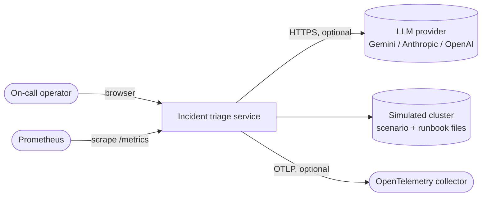
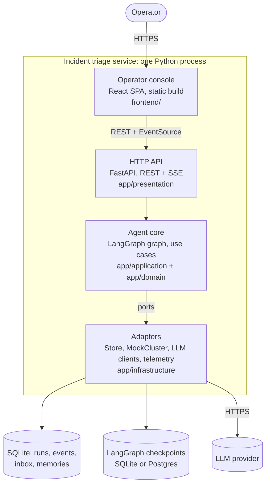
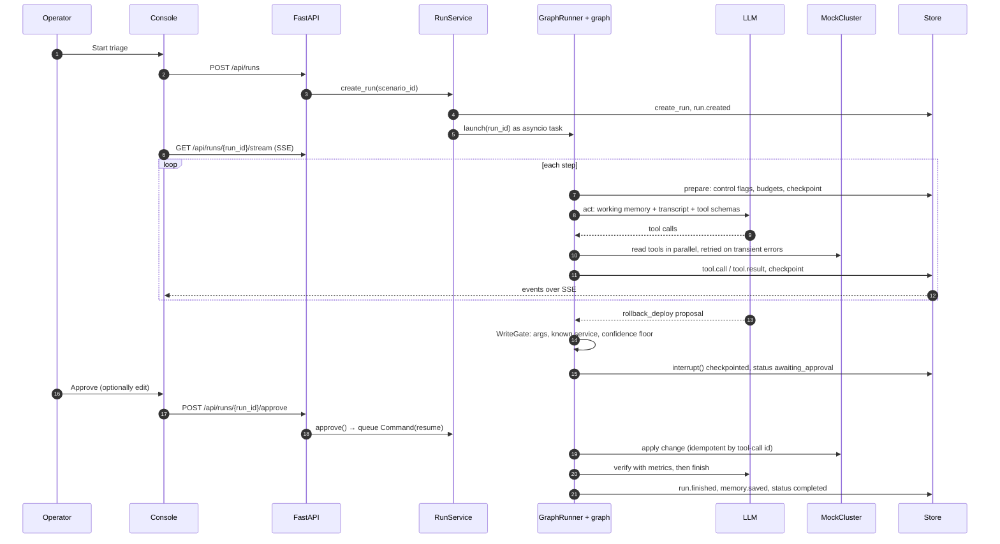
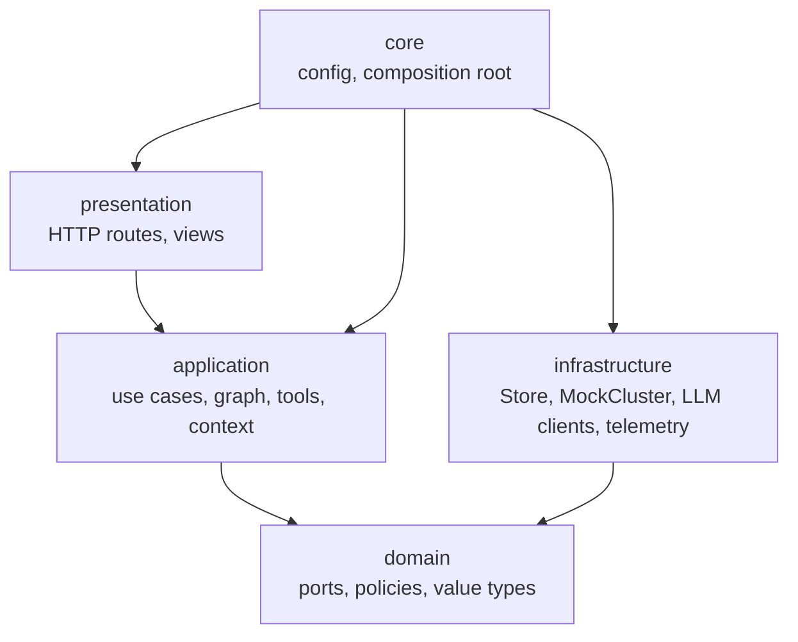

# High-Level Design: Incident Triage Agent

Companion documents: [Low-Level Design](LLD.md) · [Architecture decisions](adr/README.md) · [Architecture review guide](ARCHITECTURE_REVIEW.md) · [Documentation methods](DOC_METHODS.md)

The structure follows the order of a system-design interview: requirements,
estimates, context, containers, flows, data, then failure modes, scaling and
trade-offs. Section titles map to arc42 chapters (noted in brackets) and the
diagrams follow the C4 model (level 1 context, level 2 containers). Level 3
(components) and code-level detail are in the [LLD](LLD.md).

## 1. Problem statement [arc42 §1]

An on-call engineer receives a production alert. The service investigates it on
their behalf: it plans, calls typed read tools (alert, services, metrics, logs,
deploy history, runbooks), forms and tests hypotheses, proposes a remediation,
**stops for a human decision before any change**, applies the approved change,
verifies recovery and writes an incident report.

**Scope boundary.** Every platform tool runs against a simulated cluster
(`MockCluster`, [`app/infrastructure/cluster/mock_cluster.py`](../app/infrastructure/cluster/mock_cluster.py))
driven by the scenario files in [`scenarios/`](../scenarios). This holds even
when a live model is configured. The service holds no Kubernetes or cloud
credentials. `ClusterPort` ([`app/domain/ports.py`](../app/domain/ports.py#L42))
is the seam where a live adapter would plug in.

## 2. Requirements [arc42 §1.2, §10]

### 2.1 Functional

| ID | Requirement | Where it is met |
| --- | --- | --- |
| F1 | Start a triage run for an alert scenario | `POST /api/runs` → `RunService.create_run` |
| F2 | Agent loop: plan, call tools, revise hypotheses, finish with a report | LangGraph graph `prepare → act → gates` |
| F3 | No production change without operator approval; operator may edit or reject | `WriteGate` + `approval_node` (`interrupt()`) |
| F4 | Agent can ask the operator a question and wait | `ask_operator` tool + `input_node` |
| F5 | Operator can message, pause, resume, cancel; an emergency stop cancels all runs | `RunService` commands |
| F6 | Live activity view and full audit trail | Event log → SSE; `GET /events/verify` |
| F7 | Remember resolved incidents per service and recall them later | `IncidentMemory` port, `memory.*` events |

### 2.2 Non-functional (quality goals)

| Quality | Target | Mechanism |
| --- | --- | --- |
| Safety | Zero unapproved writes | Write tools only run from the approval node; confidence floor and scope check before a gate opens |
| Durability | A crash or restart loses at most the step in flight | Store checkpoint with CAS + LangGraph checkpointer per step; restart marks runs `interrupted`; resume continues |
| Auditability | Tampering with the event log is detectable | SHA-256 hash chain per run |
| Bounded cost | A run cannot exceed its step, token or cost ceiling | Budget check at every step boundary |
| Testability | Whole system runs offline and deterministically | `ScriptedPolicy` provider; ports with fakes; architecture tests |
| Operability | Health, readiness, metrics, traces, structured logs | `/healthz`, `/readyz`, `/metrics`, OTLP, structlog |
| Maintainability | Layers cannot leak | `tests/test_architecture.py` enforces the dependency rule and size budgets |

### 2.3 Out of scope

Live cluster access, multi-tenant isolation, an identity provider (operator
identity is a self-declared `X-Operator` header), horizontal scale-out.

## 3. Constraints and estimates [arc42 §2]

**Constraints.** Python 3.12+, FastAPI, LangGraph; SQLite by default; one
process with one uvicorn worker; the UI is a static React build served by the
same process; the whole stack must run on a laptop with no API key.

**Back-of-the-envelope.** Figures from the scripted evals and a local API audit
database (5 runs, 180 events):

| Quantity | Value | Source |
| --- | --- | --- |
| Steps per run | 7–9 | `evals/run_evals.py`, scripted provider |
| Tokens per run | 21.8k–40.5k (cost estimate $0.012–$0.022 at default prices) | same |
| Events per run | ~36 average, ~56 for a run with approval and verification | audit database |
| Event payload | ~0.5 KB average, 6.3 KB largest | audit database |
| Run state row | ~15 KB average, 29 KB largest | audit database |
| Concurrent runs | 10 (`MAX_CONCURRENT_RUNS`) | `Settings` |
| SSE polling | one `events_since` query per stream every 0.25 s | `routes.py` |

At 10 concurrent runs with two open consoles each, SSE adds about 80 small
indexed reads per second against `idx_events_run`, and a run writes well under
1 MB. SQLite handles this comfortably. Model latency, not storage, bounds the
run time.

## 4. System context (C4 level 1) [arc42 §3]

Without an API key the service selects the deterministic `ScriptedPolicy`
([`app/infrastructure/llm/scripted.py`](../app/infrastructure/llm/scripted.py)),
so it runs offline for local evaluation and CI.

## 5. Containers (C4 level 2) [arc42 §5.1]

| Container | Responsibility | Technology | Code |
| --- | --- | --- | --- |
| Operator console | Run list, live activity, approval card, operator controls, engineer details | React, TypeScript, TanStack Query, Zustand | [`frontend/src`](../frontend/src) |
| HTTP API | Validate requests, authenticate, call one use case, return views | FastAPI | [`app/presentation/http`](../app/presentation/http) |
| Agent core | Run lifecycle, the LangGraph graph, tool dispatch, policies | LangGraph, plain Python | [`app/application`](../app/application), [`app/domain`](../app/domain) |
| Adapters | Storage, simulated platform, model clients, metrics and traces | sqlite3, httpx, prometheus_client, OpenTelemetry | [`app/infrastructure`](../app/infrastructure) |
| Composition root | Pick concrete adapters, wire the object graph | plain Python | [`app/core/container.py`](../app/core/container.py) |

The four code containers share one process today; the boundaries are enforced
in code (section 11) so they can be split later without rewriting use cases.

## 6. Key flows [arc42 §6]

### 6.1 Triage with an approved change

A rejection takes the same path. The operator's feedback becomes the tool
result, nothing is executed and the agent keeps investigating.

### 6.2 Restart in the middle of a run

On startup `RunService.recover()` marks `queued` and `running` runs, and
approvals that were mid-apply, as `interrupted`. `POST /resume` restores a
pending gate or relaunches the graph from its LangGraph checkpoint. Write
actions are idempotent by tool-call id, so a replayed approval does not apply
twice.

## 7. Data and storage [arc42 §8]

| Store | Contents | Owner |
| --- | --- | --- |
| `runs` | One row per run: status, `checkpoint_version`, JSON run state | `Store` (`RunRepository`) |
| `events` | Append-only audit log with `prev_hash` / `event_hash` | `Store` (`EventLog`) |
| `inbox` | Operator messages waiting for the next step | `Store` (`OperatorInbox`) |
| `memories` | Redacted summaries of resolved incidents by service | `Store` (`IncidentMemory`) |
| LangGraph checkpoints | Graph position and pending interrupts (thread id = run id) | `open_checkpointer` |

The Store row is the source of truth for the UI and API. The LangGraph
checkpoint is the source of truth for where the graph resumes. Both are
written every step. The ER diagram and hash formula are in
[LLD §8–9](LLD.md#8-data-model).

## 8. API overview

REST for commands and reads, Server-Sent Events for the live activity stream.
`EventSource` resumes from `Last-Event-ID`, so a dropped connection replays
missed events. The full route table and error mapping are in
[LLD §10](LLD.md#10-http-api).

## 9. Cross-cutting concepts [arc42 §8]

### 9.1 Human in the loop and governance

| Control | Mechanism | Code |
| --- | --- | --- |
| Approval gate | Write tools route to `approval_node`, which calls `interrupt()` | [`gates.py`](../app/application/agent/nodes/gates.py#L18) |
| Confidence floor | Proposals below `MIN_WRITE_CONFIDENCE` go back to the agent without paging a human | [`policy.py`](../app/domain/policy.py#L36), [`write_gate.py`](../app/application/write_gate.py#L19) |
| Scope check | Unknown services are blocked (`policy.blocked`) before a gate opens | [`write_gate.py`](../app/application/write_gate.py#L19) |
| Edit before approve | Edited arguments are re-validated by the tool's Pydantic model | [`RunService.approve`](../app/application/run_service.py#L199) |
| Hash-chained audit | `GET /api/runs/{run_id}/events/verify` recomputes the chain | [`store.py`](../app/infrastructure/persistence/store.py#L211) |
| Budgets | Step, token and cost ceilings; soft stop to `needs_attention` or, with `BUDGET_HARD_STOP=true`, cancel | [`budget.py`](../app/domain/budget.py#L33) |
| Loop guard | Same tool and arguments `MAX_IDENTICAL_TOOL_CALLS` times → `needs_attention` | [`guards.py`](../app/domain/guards.py#L38) |
| Prompt-injection flag | Instruction-like text in tool output is flagged and marked as untrusted data | [`tool_executor.py`](../app/application/tool_executor.py#L26) |

The audit chain is tamper-evident, not tamper-proof: anyone with write access to
the database file can rewrite the whole chain.

### 9.2 Observability

- **Logs:** structlog, text or JSON, with a redaction processor for key, token
  and secret patterns.
- **Traces:** one OpenTelemetry span per LLM call with GenAI attributes,
  exported over OTLP/HTTP when `OTLP_ENDPOINT` is set. Span attributes are also
  stored as `gen_ai.span` events.
- **Metrics:** Prometheus at `/metrics`: LLM calls, tokens, cost, latency, tool
  calls, approvals, runs by status, events by type.
- All three sit behind `TelemetryPort`, so the application layer never imports
  an exporter ([`telemetry.py`](../app/infrastructure/observability/telemetry.py#L11)).
- **Langfuse:** a client is created when both keys are set, but generations are
  not sent to it yet.

### 9.3 Security

- Optional bearer token (`API_TOKEN`, at least 16 characters, compared with
  `hmac.compare_digest`). SSE also accepts `?token=` because `EventSource`
  cannot set headers. Probes and `/metrics` carry no run data and stay open.
- `X-Operator` is sanitised and recorded in the audit log. It is
  self-declared, not authenticated.
- Security headers (CSP, `X-Frame-Options: DENY`, `nosniff`, no-referrer), a
  request-size limit, and CORS off unless `CORS_ORIGINS` is set.
- Secrets come from the environment or a git-ignored `.env`. The container runs
  as UID 10001.

## 10. Deployment view [arc42 §7]

| Mode | Command | Notes |
| --- | --- | --- |
| Local, one command | `LLM_PROVIDER=scripted REQUIRE_LLM=false bash scripts/quickstart.sh` | Creates `.venv`, builds `frontend/dist`, serves on `127.0.0.1:8000` |
| Local development | `make dev` + `make frontend-dev` | Vite on `:5173` proxies `/api` and SSE to `:8000` |
| PyCharm | Shared run configurations in [`.run/`](../.run) | See [PYCHARM_DEMO.md](PYCHARM_DEMO.md) |
| Container | `docker compose up --build` | Multi-stage [`Dockerfile`](../Dockerfile): Node builds the UI, Python serves it as an unprivileged user; data on `/data`; healthcheck on `/readyz` |

When `DATABASE_URL` points at Postgres, only the LangGraph checkpointer moves
to `AsyncPostgresSaver`; the Store stays on SQLite at `DB_PATH`.

## 11. Architecture and building blocks [arc42 §4–5]

The backend uses ports and adapters with five packages:

Dependencies point inward. Domain has no third-party imports; application
depends on domain ports only; infrastructure implements those ports; the
composition root in `app/core/container.py` is the only module that knows
every concrete class. [`tests/test_architecture.py`](../tests/test_architecture.py)
fails the build if any rule is broken. Classes, patterns and SOLID mapping are
in [LLD §2–4 and §13–14](LLD.md#2-layers-and-the-dependency-rule).

## 12. Failure modes [arc42 §8, §11]

| Failure | Detection | Handling |
| --- | --- | --- |
| Transient tool error or timeout | `ToolTransientError`, `asyncio.wait_for` | Up to `TOOL_MAX_ATTEMPTS` with exponential backoff; `tool.retry` events |
| Permanent tool error | `ToolError` | Returned to the model as an error result so it can adapt |
| LLM rate limit or 5xx | `LLMTransientError` | Tenacity retry with jittered backoff, honours `Retry-After`; Gemini switches to the fallback model on quota errors |
| Non-retryable LLM error | `LLMError` | Run → `failed`; resumable |
| Model stops calling tools | Empty tool-call list | Up to two nudges, then `needs_attention` |
| Process crash or restart | Startup recovery | Runs marked `interrupted`; resume from checkpoint |
| Concurrent writes to a run | `checkpoint_version` CAS | One rebase retry, then HTTP 409 |
| Double-clicked approval | Per-run gate lock | Second request is a no-op |
| Overload | Active task count | HTTP 429 with `Retry-After: 30` |
| Event log tampering | Hash mismatch | `/events/verify` returns `ok: false` and the first bad `seq` |

## 13. Scalability and evolution

The service runs as **one process with one uvicorn worker**. Active runs are
`asyncio` tasks owned by that process, and pause/cancel flags live in memory.
To scale out:

1. Move the Store to Postgres (the SQLAlchemy models and Alembic migration
   already mirror the four tables) and keep `checkpoint_version` CAS.
2. Add run leases (row lock or `lease_until` column) so exactly one worker
   drives a run, and move control flags into the database.
3. Replace SSE polling with `LISTEN/NOTIFY` or a message bus fan-out.
4. Add a live `ClusterPort` adapter with scoped credentials per environment.

None of these changes touch the application or domain layers, because they sit
behind `RunRepository`, `EventLog` and `ClusterPort`.

## 14. Alternatives considered [arc42 §9]

Each decision has an ADR with context, options and consequences.

| Decision | Chosen | Rejected | ADR |
| --- | --- | --- | --- |
| Orchestration | LangGraph `StateGraph` with `interrupt()` | Hand-written loop; a task queue (Celery/Temporal) | [ADR-0001](adr/0001-langgraph-interrupt-for-human-gates.md) |
| Storage and audit | SQLite Store with CAS and a hash-chained event log | Postgres from day one; LangGraph checkpoints as the only state | [ADR-0002](adr/0002-sqlite-store-with-hash-chained-event-log.md) |
| Code structure | Ports and adapters with one composition root | Framework DI container; FastAPI `Depends` all the way down | [ADR-0003](adr/0003-ports-and-adapters-with-composition-root.md) |
| Offline model | Deterministic scripted provider | Recorded cassettes; live model in CI | [ADR-0004](adr/0004-deterministic-scripted-llm-provider.md) |
| Process model | Single worker | Multiple workers with leases | [ADR-0005](adr/0005-single-worker-process-model.md) |
| Extension points | Registries and CQRS-lite split | if/elif chains in nodes; one service class | [ADR-0006](adr/0006-registries-and-cqrs-lite-split.md) |

## 15. Risks and technical debt [arc42 §11]

| Risk | Impact | Mitigation today | Next step |
| --- | --- | --- | --- |
| Two checkpoints (Store row and LangGraph) drift | Resume shows a stale gate | Gate nodes re-read the Store after `interrupt()`; tests cover crash resume | Single transaction when both live in Postgres |
| Synchronous SQLite calls on the event loop | Latency under heavy load | Small rows, indexed reads | Async driver or a thread pool |
| Self-declared operator identity | Audit names can be spoofed | Header sanitised and recorded | OIDC |
| Scripted provider hides live-model behaviour | CI passes while a live model fails | Opt-in live smoke test (`-m live`) | Scheduled live evals |
| Event log grows without bound | Disk usage | Small payloads | Retention and signed export |

## 16. Glossary [arc42 §12]

| Term | Meaning |
| --- | --- |
| Run | One triage of one alert, from creation to a terminal status |
| Step | One `prepare → act` iteration: one model call and its tool calls |
| Gate | A paused graph waiting for an operator: approval of a write, or an answer |
| Working memory | Plan, hypotheses, action log and notes rendered into every prompt; never compacted |
| Port | A `typing.Protocol` the application depends on; an adapter implements it |
