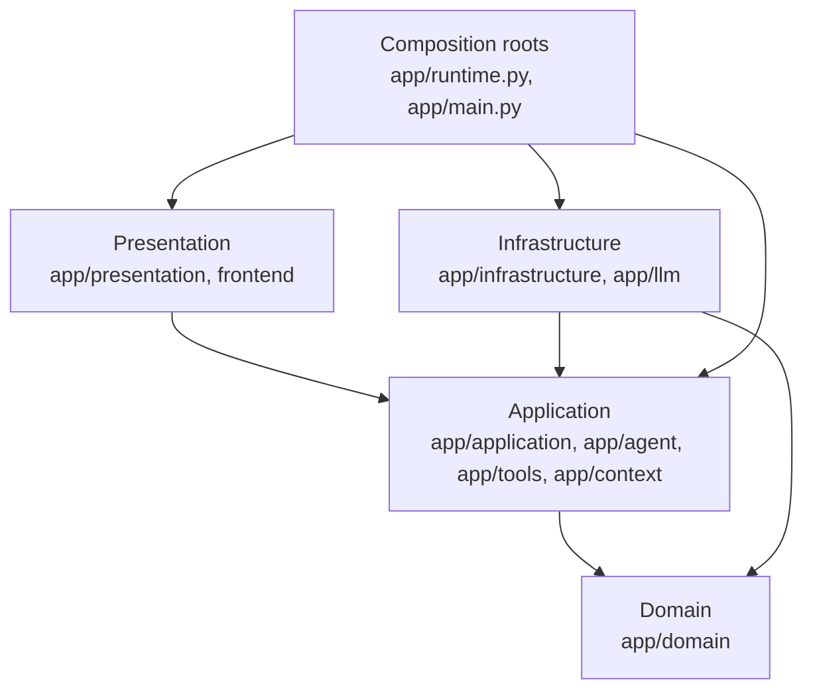
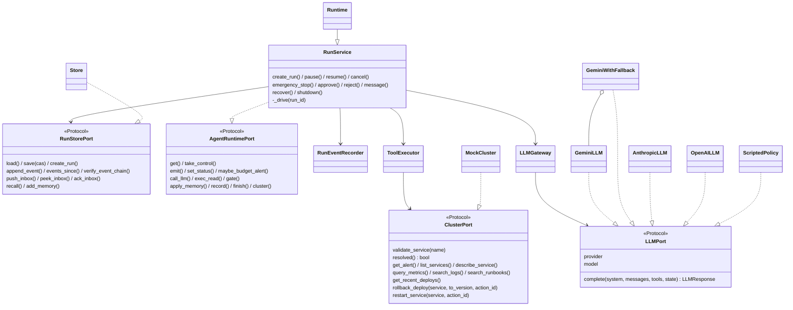
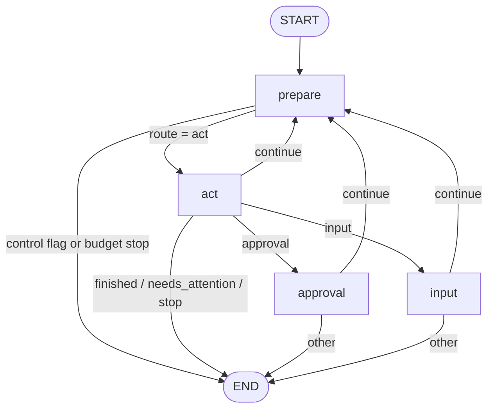
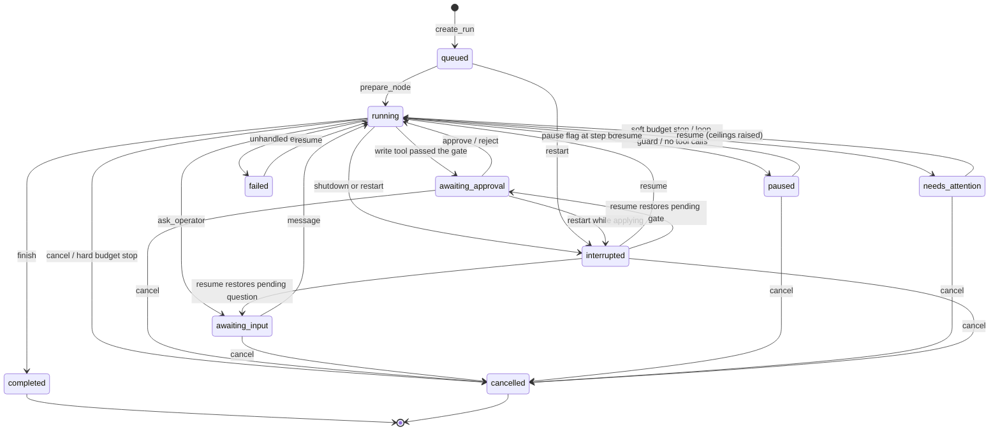
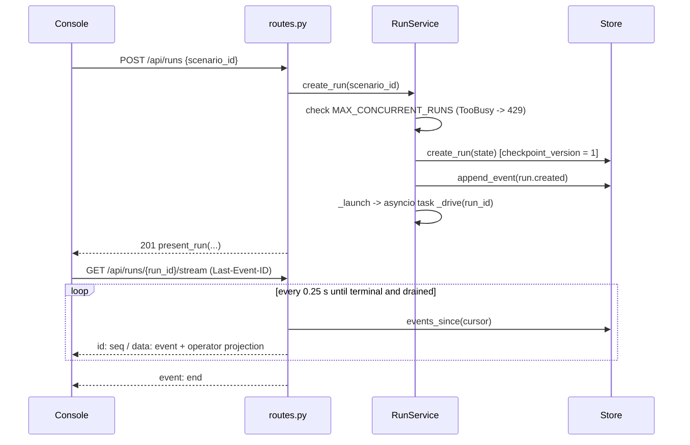
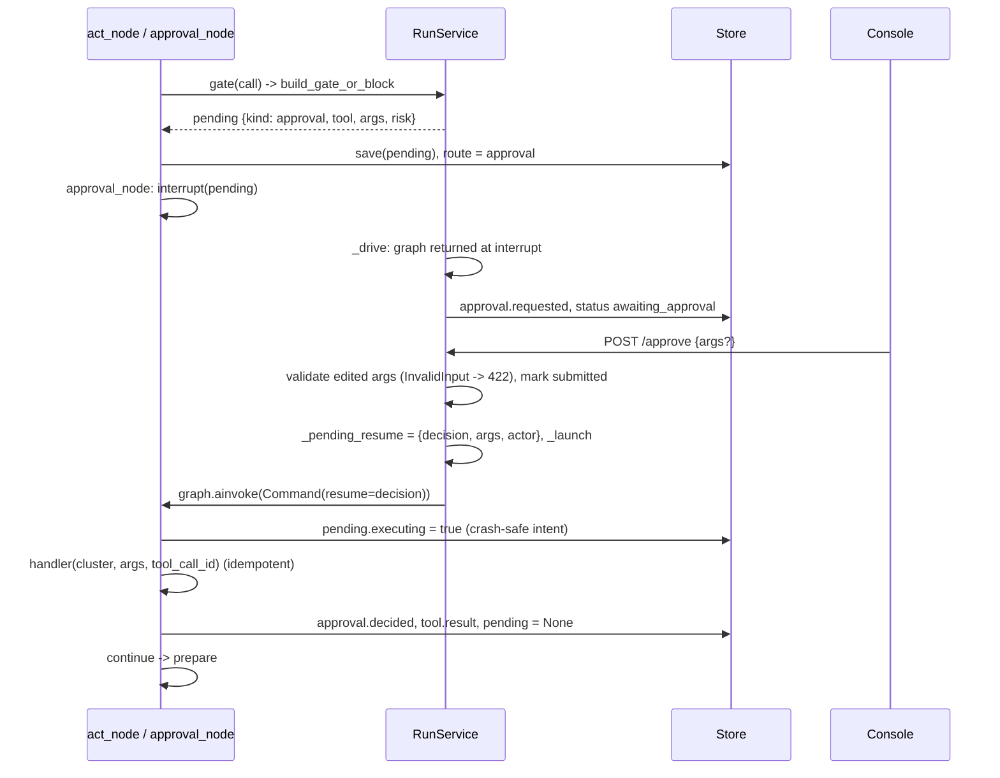
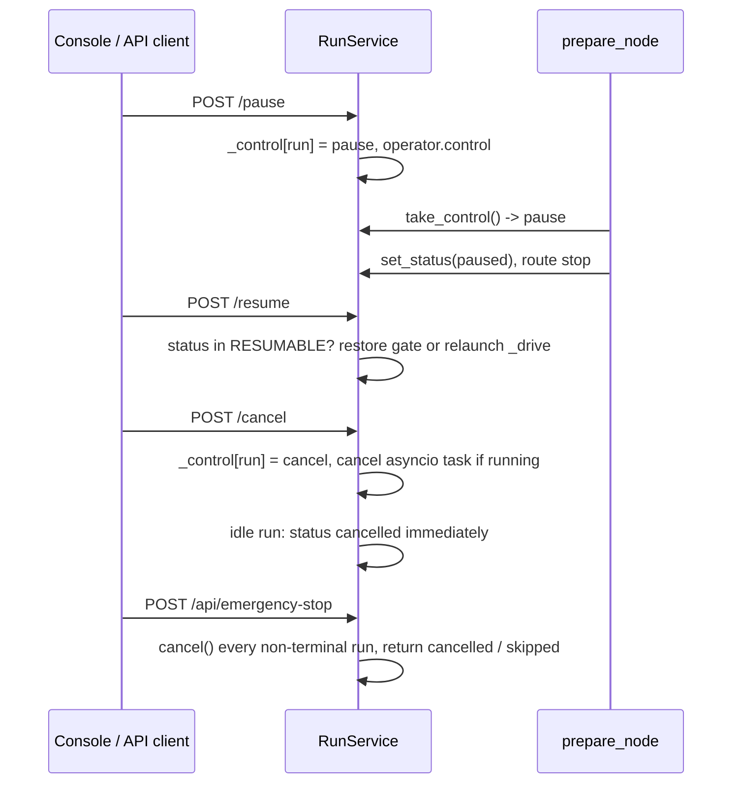
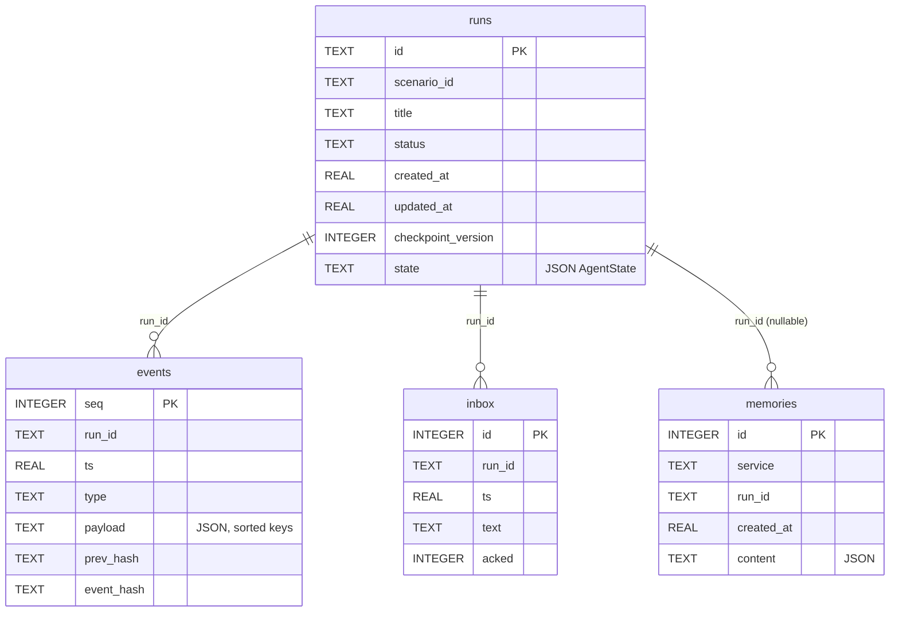
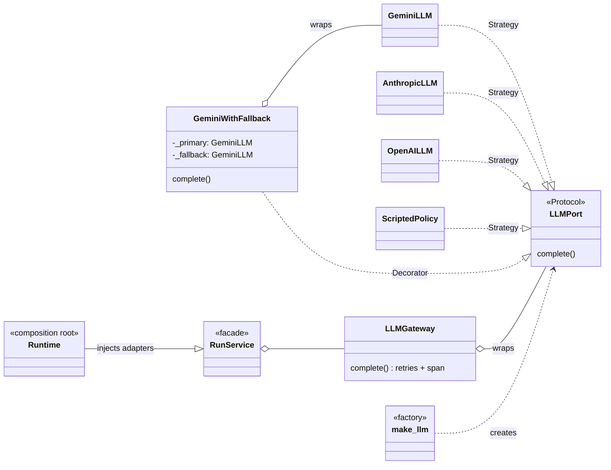

# Low-Level Design: Incident Triage Agent

Companion documents: [High-Level Design](HLD.md) · [Architecture review guide](ARCHITECTURE_REVIEW.md) · [PyCharm demo](PYCHARM_DEMO.md)

Line anchors (`#L52`) match the current `main`; if code moves, file paths and
symbol names are the stable reference.

Contents: 1 Project structure · 2 Layers · 3 Key types (class diagram) · 4 LangGraph
graph · 5 Run lifecycle (state machine) · 6 Sequences · 7 Tool registry · 8 Data
model (ER) · 9 HTTP API · 10 Events and hash chain · 11 Frontend · 12 Errors and
retries · 13 Configuration · 14 Testing · 15 Design patterns · 16 SOLID

## 1. Project structure

```text
app/
  domain/              Pure Python: ports, policies, value types. Imports only stdlib + app.domain.
    ports.py           LLMPort, ClusterPort, RunStorePort (typing.Protocol)
    policy.py          risk_for_kind, evaluate_write_confidence, WriteGateDecision
    budget.py          budget_crossings (step / token / cost alert policy)
    guards.py          LoopGuard, find_injection_markers
    lifecycle.py       TERMINAL, RESUMABLE, NUDGE
    llm.py             ToolCall, LLMResponse, LLMError, LLMTransientError
    errors.py          ToolError, ToolTransientError (raised by ClusterPort adapters)
    memory.py          make_memory, redact (what may be remembered across runs)
    labels.py          status / severity wording, alert_card
  application/         Use cases. Depends on domain ports, never on adapters or FastAPI.
    run_service.py     RunService: lifecycle + LangGraph drive loop
    ports.py           AgentRuntimePort and factory types injected by the composition root
    events.py          RunEventRecorder: append audit events, persist status
    llm_gateway.py     LLMGateway: retry/backoff + GenAI span around LLMPort
    tool_executor.py   ToolExecutor: read-tool retries/timeouts, result recording
    write_gate.py      build_gate_or_block: argument, scope, confidence checks
    working_memory.py  apply_working_memory
    exceptions.py      NotFound, RunStateError, InvalidInput, TooBusy, ConcurrencyConflict
  agent/               LangGraph orchestration (application layer)
    graph.py           build_agent_graph: nodes and conditional edges
    nodes/             prepare_node, act_node, approval_node, input_node
    state.py           AgentState, new_run_state, make_run_id
    deps.py            runtime_from(config) -> AgentRuntimePort
  tools/               Tool catalog: typed argument models, schemas, kinds (application layer)
  context/             Prompt and context-window construction (application layer)
  infrastructure/      Adapters behind domain ports
    store.py           Store (RunStorePort), CheckpointConflict
    mock_cluster.py    MockCluster (ClusterPort), load_scenario, list_scenarios
    runbooks.py        search_runbooks over runbooks/*.md
    checkpointer.py    open_checkpointer (SQLite or Postgres LangGraph saver)
    cluster.py         cluster_for_run (adapter factory)
    llm_factory.py     re-exports make_llm, resolve_provider
  llm/                 LLM adapters (infrastructure): GeminiLLM, GeminiWithFallback,
                       AnthropicLLM, OpenAILLM, ScriptedPolicy, make_llm
  presentation/        Outermost layer
    http/              routes.py, schemas.py, dependencies.py, errors.py, middleware.py
    run_view.py        present_run: public run payload
    operator.py        plain-language projections (pending, events, report, errors)
  observability/       structlog setup, OpenTelemetry spans, Prometheus metrics, Langfuse client
  config/              Settings (pydantic-settings), ConfigError, load_dotenv
  db/                  SQLAlchemy models + Alembic migration (same tables as the Store)
  runtime.py           Composition: Runtime = RunService + default adapters
  main.py              HTTP composition root: create_app(), app
frontend/src/
  features/run/        useActiveRun, useRunActions, useRunStream, useStartRun, queries.ts
  features/approval/   ApprovalCard
  components/          layout, runs list, run timeline/side panel, shared UI primitives
  lib/                 api client, queryKeys, types, error mapping, formatting
  store/uiStore.ts     Zustand: client-only UI state
  hooks/               useElapsed (generic)
  pages/               ConsolePage
tests/                 pytest suites incl. test_architecture.py (layer boundaries)
evals/                 scenario evaluation harness
scripts/               quickstart, Playwright E2E, screenshots, live checks
scenarios/, runbooks/  simulated platform data
.run/                  shared PyCharm run configurations
```

## 2. Layers and the dependency rule



Rules, all enforced by [`tests/test_architecture.py`](../tests/test_architecture.py):

1. `app.domain` imports only the standard library and other domain modules.
2. `app.application`, `app.agent`, `app.tools`, `app.context` never import
   `app.infrastructure`, `app.llm`, `app.presentation`, `app.main`,
   `app.runtime`, FastAPI/Starlette, SQLAlchemy, `sqlite3`, `aiosqlite`, or `httpx`.
3. `app.infrastructure` and `app.llm` never import presentation or FastAPI.
4. `app.presentation` never imports infrastructure, `app.llm`, or database drivers.
5. `app/main.py` defines no API routes (only the SPA shell at `/`).
6. Every adapter is an instance of its port (`isinstance` against
   `runtime_checkable` Protocols), and `Runtime` satisfies `AgentRuntimePort`.

Allowed cross-cutting imports: `app.config` (settings) and `app.observability`
(tracing and metrics helpers) from the application layer.

## 3. Key types



| Type / function | Role | File |
| --- | --- | --- |
| `RunService` | Lifecycle use cases; constructor takes `store`, `llm`, `settings`, `cluster_factory`, `checkpointer_factory`, `scenario_loader`, `present_pending`, `scenario_catalog` | [`app/application/run_service.py#L52`](../app/application/run_service.py#L52) |
| `Runtime` | Supplies `cluster_for_run`, `open_checkpointer`, `load_scenario`, `enrich_pending`, `list_scenarios` | [`app/runtime.py#L35`](../app/runtime.py#L35) |
| `make_llm` | Strategy factory: `auto` picks Gemini → Anthropic → OpenAI by available key, else scripted | [`app/llm/providers.py#L421`](../app/llm/providers.py#L421) |
| `cluster_for_run` | Factory: `MockCluster(load_scenario(id), env)` bound to the run's checkpointed env | [`app/infrastructure/cluster.py#L9`](../app/infrastructure/cluster.py#L9) |
| `build_tool_registry` / `TOOLS` | Tool catalog; `ToolSpec(name, description, kind, model, handler)` | [`app/tools/specs.py#L92`](../app/tools/specs.py#L92) |
| `build_gate_or_block` | Validates args, blocks unknown services and low confidence, builds the pending approval | [`app/application/write_gate.py#L16`](../app/application/write_gate.py#L16) |
| `evaluate_write_confidence` | Pure confidence-floor decision | [`app/domain/policy.py#L36`](../app/domain/policy.py#L36) |
| `present_run`, `enrich_pending`, `event_display` | Operator projections added beside canonical data | [`app/presentation/run_view.py`](../app/presentation/run_view.py), [`app/presentation/operator.py`](../app/presentation/operator.py) |

## 4. LangGraph graph

Built in [`app/agent/graph.py`](../app/agent/graph.py); the run id is the thread id.



| Node | Responsibility |
| --- | --- |
| `prepare_node` | Pop pause/cancel flag (`take_control`), enforce step/token/cost budgets, set `running`, emit budget alerts |
| `act_node` | Drain operator inbox, build context, call LLM, dispatch tools: reads in parallel, `update_working_memory`, at most one gate, `finish`; loop guard; nudges |
| `approval_node` | `interrupt(pending)`; on resume apply (approved, possibly edited) or record rejection; idempotent by tool-call id |
| `input_node` | `interrupt(pending)` for `ask_operator`; record the operator's answer |

## 5. Run lifecycle

Statuses are set only through `RunEventRecorder.set_status`, which also emits
`run.status`. Sets: `TERMINAL = {completed, failed, cancelled}`,
`RESUMABLE = {paused, interrupted, failed, needs_attention}`
([`app/domain/lifecycle.py`](../app/domain/lifecycle.py)).



`failed` is terminal for cancel purposes but resumable: resume retries from
the last checkpoint.

## 6. Sequences

### 6.1 Start a run and stream events



### 6.2 Approval interrupt and resume



### 6.3 Pause, resume, cancel, emergency stop



## 7. Tool registry

Defined in [`app/tools/specs.py`](../app/tools/specs.py). Risk comes from
`risk_for_kind`: `write` → `high`, otherwise `low`.

| Tool | Kind | Risk | Arguments | Behaviour |
| --- | --- | --- | --- | --- |
| `get_alert` | read | low | none | Alert that started the run |
| `list_services` | read | low | none | Services, versions, pod status, owners |
| `describe_service` | read | low | `service` | Version, replicas, health, dependencies, config |
| `query_metrics` | read | low | `service`, `metric`, `window_minutes` (5–360) | Time series with baseline |
| `search_logs` | read | low | `service`, `query`, `limit` (1–500) | Matching log lines |
| `search_runbooks` | read | low | `query`, `top_k` (1–3) | Runbook excerpts |
| `get_recent_deploys` | read | low | `service` | Deploy history and actions taken in this incident |
| `rollback_deploy` | write | high | `service`, `to_version`, `reason`, `confidence` | Requires approval; idempotent by tool-call id |
| `restart_service` | write | high | `service`, `reason`, `confidence` | Requires approval; idempotent by tool-call id |
| `update_working_memory` | meta | low | `plan`, `hypotheses`, `note` | Durable plan/hypotheses that survive compaction |
| `ask_operator` | meta | low | `question` | Pauses for an operator answer |
| `finish` | meta | low | `summary`, `root_cause`, `resolved`, `fix_applied`, `follow_ups` | Ends the run with a report |

## 8. Data model

The Store creates these tables ([`app/infrastructure/store.py`](../app/infrastructure/store.py));
the SQLAlchemy models in [`app/db/models.py`](../app/db/models.py) mirror them.
The Alembic migration [`0001_initial_schema.py`](../app/db/migrations/versions/0001_initial_schema.py)
creates `events` without `prev_hash`/`event_hash`; the Store adds both columns
on startup when they are missing.



Relationships are logical (by `run_id`); no foreign-key constraints are
declared. Index: `idx_events_run (run_id, seq)`. The LangGraph checkpointer keeps
its own tables in a separate database.

## 9. HTTP API

Routes: [`app/presentation/http/routes.py`](../app/presentation/http/routes.py).
"Auth" means the bearer token is checked when `API_TOKEN` is set.

| Method | Path | Auth | Purpose |
| --- | --- | --- | --- |
| GET | `/` | no | Built React console (or a short API page if `frontend/dist` is missing) |
| GET | `/healthz` | no | Liveness |
| GET | `/readyz` | no | Readiness: Store ping, provider name |
| GET | `/metrics` | no | Prometheus exposition |
| GET | `/api/health` | yes | Provider, model, limits, whether auth is on |
| GET | `/api/scenarios` | yes | Scenario cards |
| GET | `/api/tools` | yes | Tool schemas (`name`, `description`, `kind`, `input_schema`) |
| POST | `/api/runs` | yes | Create a run (`201`; `404` unknown scenario; `429` too busy) |
| GET | `/api/runs` | yes | Recent runs |
| GET | `/api/runs/{run_id}` | yes | Run view; `?include_history=true` adds the transcript |
| GET | `/api/runs/{run_id}/context` | yes | Prompt the model would see next |
| GET | `/api/runs/{run_id}/events` | yes | Event history after `?after=` with operator projections |
| GET | `/api/runs/{run_id}/stream` | yes (`?token=` allowed) | SSE; resumes from `Last-Event-ID` |
| GET | `/api/runs/{run_id}/events/verify` | yes | Recompute the hash chain |
| POST | `/api/runs/{run_id}/approve` | yes | Approve, optionally with edited `args` |
| POST | `/api/runs/{run_id}/reject` | yes | Reject with optional `feedback` |
| POST | `/api/runs/{run_id}/message` | yes | Message the agent or answer its question |
| POST | `/api/runs/{run_id}/pause` | yes | Pause at the next step boundary |
| POST | `/api/runs/{run_id}/resume` | yes | Resume a resumable run |
| POST | `/api/runs/{run_id}/cancel` | yes | Cancel |
| POST | `/api/emergency-stop` | yes | Cancel every non-terminal run |

Errors ([`app/presentation/http/errors.py`](../app/presentation/http/errors.py)):
`NotFound` 404, `RunStateError` 409, `ConcurrencyConflict` 409,
`InvalidInput` 422, `TooBusy` 429. Bodies are `{"detail": ..., "operator": {...}}`.

## 10. Events and the hash chain

Every event is a row `{seq, run_id, ts, type, payload, prev_hash, event_hash}`;
`payload` always includes `step`. The API adds a top-level `operator`
projection outside the hashed payload.

| Type | Emitted when |
| --- | --- |
| `run.created`, `run.status`, `run.finished` | Run created, status changed, report written |
| `memory.recalled`, `memory.update`, `memory.saved` | Past incidents recalled, working memory updated, resolved incident remembered |
| `llm.call`, `gen_ai.span`, `llm.retry`, `agent.message` | Model call metrics, span attributes, retry, model text |
| `tool.call`, `tool.result`, `tool.retry` | Tool dispatched, result recorded, transient retry |
| `approval.requested`, `approval.decided`, `input.requested` | Human gates |
| `operator.control`, `operator.message` | Pause/resume/cancel, operator messages |
| `policy.blocked`, `security.injection_flagged`, `budget.alert`, `context.compacted` | Governance and context signals |

Hash: `event_hash = sha256(f"{prev_hash}|{run_id}|{ts:.6f}|{type}|{payload_json}")`
with `payload_json = json.dumps(payload, sort_keys=True, default=str)` and
`prev_hash = ""` for a run's first event (`Store._event_hash`).
`verify_event_chain` walks a run's events in `seq` order and returns
`{"ok": true, "events": n}` or `{"ok": false, "seq": n, "reason": ...}`.

## 11. Frontend

| Concern | Implementation |
| --- | --- |
| Routing | `HashRouter`: `/` and `/runs/:runId` → `ConsolePage` |
| Server state | TanStack Query; keys in [`lib/queryKeys.ts`](../frontend/src/lib/queryKeys.ts): `['health']`, `['scenarios']`, `['runs']`, `['run', id]`, `['context', id]` |
| Data hooks | [`features/run/hooks/queries.ts`](../frontend/src/features/run/hooks/queries.ts) (`useHealth`, `useScenarios`, `useRuns`, `useRunContext`), `useActiveRun` (run query + SSE, polling while active), `useStartRun` |
| Actions | `useRunActions(runId)`: approve, reject, message, pause, resume, cancel with error toasts |
| Streaming | `useRunStream`: `EventSource`, de-duplication by `seq`, reconnect with backoff, reducer `streamReducer` |
| Client state | Zustand [`store/uiStore.ts`](../frontend/src/store/uiStore.ts): operator name, theme, SSE status, thinking phase, engineer-details toggle |
| Display | Components render the API's `operator` projections (`title`, `summary`, `fields`, `evidence`, `impact`); raw data only under "For engineers" |

## 12. Error handling and retries

| Where | Policy |
| --- | --- |
| `ToolExecutor.execute_read` | `asyncio.wait_for(TOOL_TIMEOUT_S)`; `ToolTransientError`/timeout retried `TOOL_MAX_ATTEMPTS` times with `TOOL_BACKOFF_S * 2^(n-1)`; `ToolError` returned to the model |
| `LLMGateway.complete` | Tenacity: `LLM_MAX_ATTEMPTS`, jittered exponential backoff between `LLM_BACKOFF_S` and `LLM_MAX_BACKOFF_S`, honours `retry_after_s` |
| `GeminiWithFallback` | On quota / 429 switches to `GEMINI_FALLBACK_MODEL` for the rest of the process |
| `RunService._drive` | Unhandled exception → `failed` with message; operator cancel → `cancelled`; process shutdown → `interrupted` |
| `Store.save` | CAS on `checkpoint_version`, one rebase retry, then `CheckpointConflict` (409) |
| `RunService.approve` | Idempotent under double-click; invalid edits → 422 before the graph runs |
| Frontend | `mapError` turns API errors into operator copy; `ErrorBoundary`; SSE reconnect banner |

## 13. Configuration

All settings are fields of `Settings` ([`app/config/settings.py`](../app/config/settings.py)),
overridable by upper-case environment variables or `.env`. Provider keys
(`GEMINI_API_KEY` or `GOOGLE_API_KEY`, `ANTHROPIC_API_KEY`, `OPENAI_API_KEY`) are
read from the environment by `make_llm`. [`.env.example`](../.env.example) lists them with empty values.

| Group | Variables (default) |
| --- | --- |
| Model | `LLM_PROVIDER` (auto), `GEMINI_MODEL`, `GEMINI_FALLBACK_MODEL`, `ANTHROPIC_MODEL`, `OPENAI_MODEL`, `REQUIRE_LLM` (false), `LLM_TIMEOUT_S` (120), `LLM_MAX_ATTEMPTS` (4), `LLM_BACKOFF_S` (1), `LLM_MAX_BACKOFF_S` (60), `LLM_MAX_OUTPUT_TOKENS` (8192), `SCRIPTED_DELAY_S` (0.8) |
| Budgets and policy | `MAX_STEPS` (25), `MAX_RUN_TOKENS` (400000), `MAX_RUN_COST_USD` (1.0), `MIN_WRITE_CONFIDENCE` (0.5), `MAX_CONCURRENT_RUNS` (10), `MAX_IDENTICAL_TOOL_CALLS` (3), `BUDGET_ALERT_RATIO` (0.8), `BUDGET_HARD_STOP` (false) |
| Context | `CONTEXT_BUDGET_TOKENS` (24000), `TOOL_OUTPUT_MAX_CHARS` (6000), `KEEP_RECENT_GROUPS` (6), `MEMORY_TTL_DAYS` (30) |
| Tools | `TOOL_MAX_ATTEMPTS` (3), `TOOL_BACKOFF_S` (0.5), `TOOL_TIMEOUT_S` (10) |
| Cost estimate | `COST_IN_PER_MTOK` (0.5), `COST_OUT_PER_MTOK` (3.0) |
| Security | `API_TOKEN` (empty = no auth), `CORS_ORIGINS`, `MAX_REQUEST_BYTES` (1048576) |
| Persistence | `DB_PATH` (data/agent.db), `DATABASE_URL`, `CHECKPOINT_DB_PATH` |
| Observability | `LOG_FORMAT` (text), `LOG_LEVEL` (INFO), `OTLP_ENDPOINT`, `LANGFUSE_PUBLIC_KEY`, `LANGFUSE_SECRET_KEY`, `LANGFUSE_HOST` |

Invalid values raise `ConfigError` at startup.

## 14. Testing strategy

| Layer / concern | Tests |
| --- | --- |
| Architecture boundaries, port conformance | [`tests/test_architecture.py`](../tests/test_architecture.py) |
| Agent loop, approval, rejection, edit, crash resume, pause, budgets, compaction, memory, HTTP round trip | [`tests/test_agent.py`](../tests/test_agent.py) |
| LangGraph topology and interrupt/resume | [`tests/test_langgraph.py`](../tests/test_langgraph.py) |
| Governance: hash chain, risk labels, scope block, hard budget stop, emergency stop | [`tests/test_governance.py`](../tests/test_governance.py) |
| Hardening: injection markers, loop guard, runbooks, budget alerts, GenAI spans | [`tests/test_hardening.py`](../tests/test_hardening.py) |
| Production: auth, security headers, input limits, 429, graceful shutdown | [`tests/test_production.py`](../tests/test_production.py) |
| Operator projections never show raw code/logs; reload and SSE agree | [`tests/test_display.py`](../tests/test_display.py) |
| Gemini adapter against a mocked API (thought signatures, errors, provider selection) | [`tests/test_gemini.py`](../tests/test_gemini.py) |
| Live Gemini smoke (opt-in, `-m live`) | [`tests/test_e2e_live.py`](../tests/test_e2e_live.py) |
| Scenario outcomes (resolved, right first fix, injection-safe) | [`evals/run_evals.py`](../evals/run_evals.py) |
| Frontend units (Vitest) | `*.test.ts(x)` under [`frontend/src`](../frontend/src) |
| Browser end to end (Playwright) | [`scripts/e2e_ui.py`](../scripts/e2e_ui.py) |

## 15. Design patterns

Only patterns present in the code are listed. Excerpts and the test that guards
each one are in the [architecture review guide](ARCHITECTURE_REVIEW.md#2-design-patterns-in-the-code).



| Pattern | Where | What it buys |
| --- | --- | --- |
| Ports and adapters | Ports [`app/domain/ports.py`](../app/domain/ports.py#L17); adapters [`Store`](../app/infrastructure/store.py#L62), [`MockCluster`](../app/infrastructure/mock_cluster.py#L61), [`app/llm/providers.py`](../app/llm/providers.py) | Storage, platform, and model are replaceable without touching use cases |
| Strategy | [`LLMPort`](../app/domain/ports.py#L18) implemented by [`GeminiLLM`](../app/llm/providers.py#L156), [`AnthropicLLM`](../app/llm/providers.py#L231), [`OpenAILLM`](../app/llm/providers.py#L292), [`ScriptedPolicy`](../app/llm/scripted.py#L76) | Live and offline models interchangeable |
| Factory | [`make_llm`](../app/llm/providers.py#L421), [`cluster_for_run`](../app/infrastructure/cluster.py#L9), [`open_checkpointer`](../app/infrastructure/checkpointer.py#L14), [`new_run_state`](../app/agent/state.py#L55) | Construction in one place; callers receive a port |
| Adapter | [`MockCluster`](../app/infrastructure/mock_cluster.py#L61) (scenario JSON → `ClusterPort`); [`to_gemini`](../app/llm/providers.py#L89) / [`to_anthropic`](../app/llm/providers.py#L194) / [`to_openai`](../app/llm/providers.py#L270) (neutral history → wire format) | One internal model, many external formats |
| Decorator | [`GeminiWithFallback`](../app/llm/providers.py#L343) (quota fallback), [`LLMGateway`](../app/application/llm_gateway.py#L17) (retries + tracing) | Behaviour added without changing the wrapped class |
| Dependency injection / composition root | [`RunService.__init__`](../app/application/run_service.py#L59), [`Runtime`](../app/runtime.py#L35), [`create_app`](../app/main.py#L45), [`get_runtime`](../app/presentation/http/dependencies.py#L14) | No hidden globals; tests pass fakes |
| Facade | [`RunService`](../app/application/run_service.py#L52): `create_run`, `approve`, `reject`, `pause`, `resume`, `cancel`, `emergency_stop` | One entry point for the HTTP layer |
| Observer | [`RunEventRecorder.emit`](../app/application/events.py#L24) → event log → [SSE route](../app/presentation/http/routes.py#L132) → `EventSource` in [`useRunStream`](../frontend/src/features/run/hooks/useRunStream.ts) | Producers decoupled from the UI; replay by `Last-Event-ID` |
| Registry | [`TOOLS`](../app/tools/specs.py#L215) of [`ToolSpec`](../app/tools/specs.py#L92) | New tool = new entry |
| State machine | Section 5 statuses; LangGraph [`StateGraph`](../app/agent/graph.py) with `interrupt()` | Explicit transitions and durable human gates |
| Repository + optimistic locking | [`Store.save`](../app/infrastructure/store.py#L97) compare-and-set on `checkpoint_version` | Lost updates detected (HTTP 409) |
| Hash chain | [`Store._event_hash`](../app/infrastructure/store.py#L162), [`verify_event_chain`](../app/infrastructure/store.py#L211) | Tamper-evident audit log |
| Policy object | [`evaluate_write_confidence`](../app/domain/policy.py#L36) → `WriteGateDecision` | Pure, unit-testable governance rule |
| Reducer / custom hooks / query-key factory (frontend) | [`streamReducer`](../frontend/src/features/run/hooks/useRunStream.ts), [`useRunActions`](../frontend/src/features/run/hooks/useRunActions.ts#L10), [`queryKeys`](../frontend/src/lib/queryKeys.ts#L2) | Side effects out of components; cache keys defined once |

## 16. SOLID

| Principle | Where it shows | Guarded by |
| --- | --- | --- |
| Single responsibility | `RunEventRecorder` records events; `ToolExecutor` runs and records tools; `LLMGateway` retries model calls; routes only translate HTTP | Exercised through `RunService` in `tests/test_agent.py` and `tests/test_hardening.py`; `test_routes_are_not_defined_in_the_composition_root` |
| Open/closed | New platform = new `ClusterPort` passed as `cluster_factory`; new tool = new `ToolSpec`; new error = one row in [`STATUS_BY_ERROR`](../app/presentation/http/errors.py#L11) | `test_adapters_implement_domain_ports` |
| Liskov substitution | Every LLM adapter, including `GeminiWithFallback` and test fakes, is used through `LLMPort` | `test_adapters_implement_domain_ports`, `test_quota_error_switches_to_fallback_model` |
| Interface segregation | Nodes see [`AgentRuntimePort`](../app/application/ports.py#L28); the run view needs only [`RunViewSource`](../app/presentation/run_view.py#L11) (two methods) | `test_runtime_satisfies_agent_runtime_port` |
| Dependency inversion | [`RunService.__init__`](../app/application/run_service.py#L59) depends on `RunStorePort`, `LLMPort`, factories; concrete classes chosen in `Runtime` | `test_application_layer_depends_on_ports_not_adapters` |

