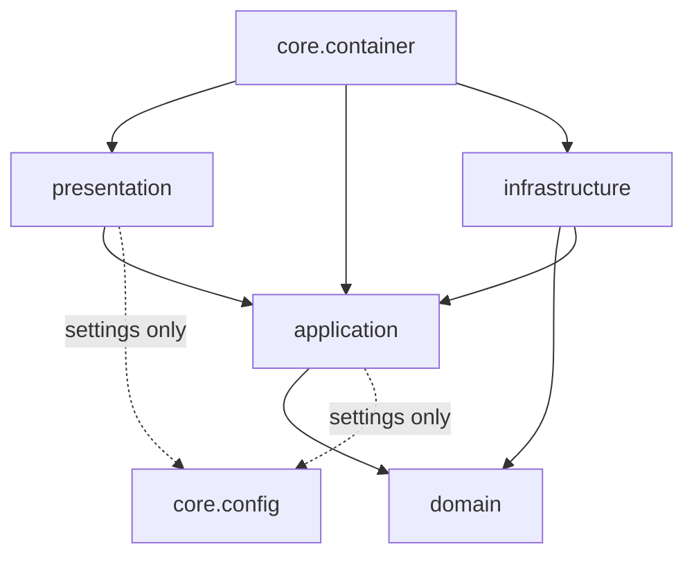
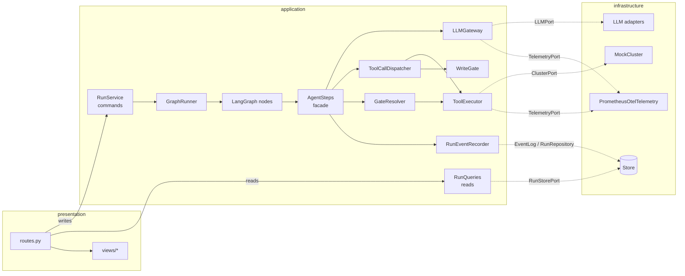
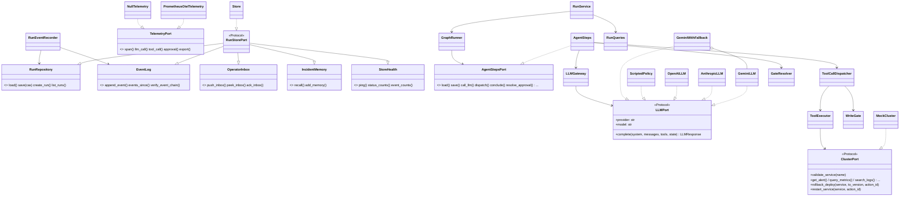
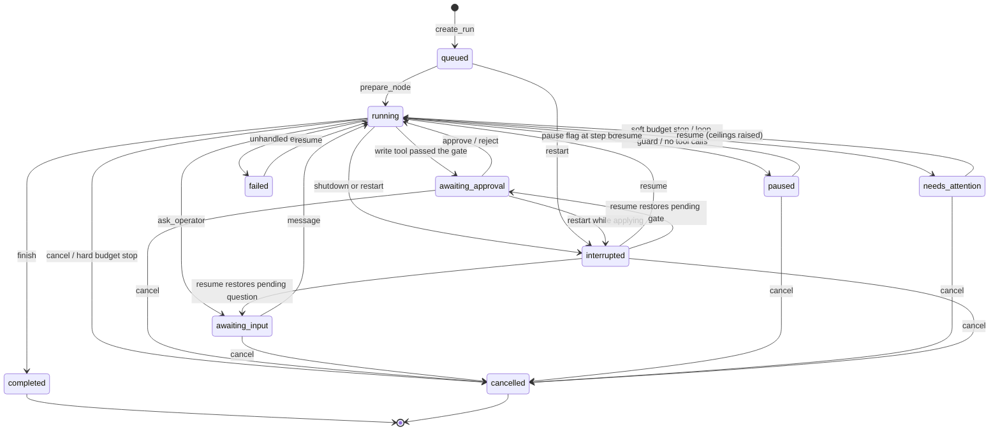
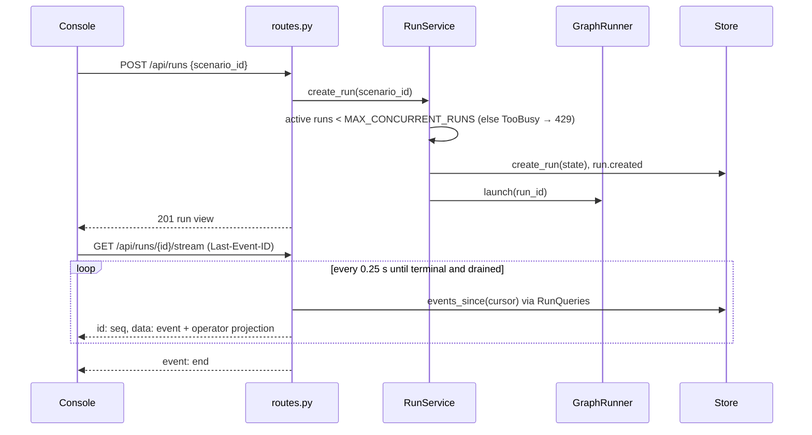
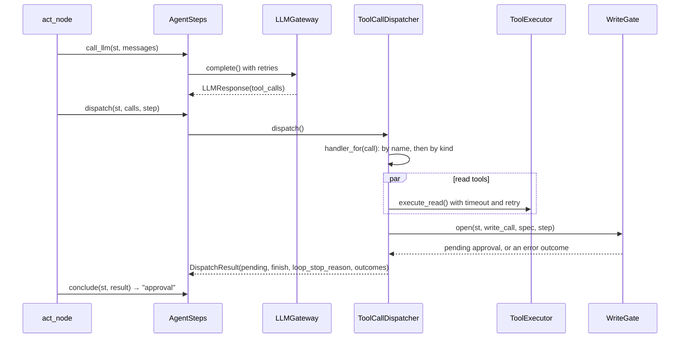
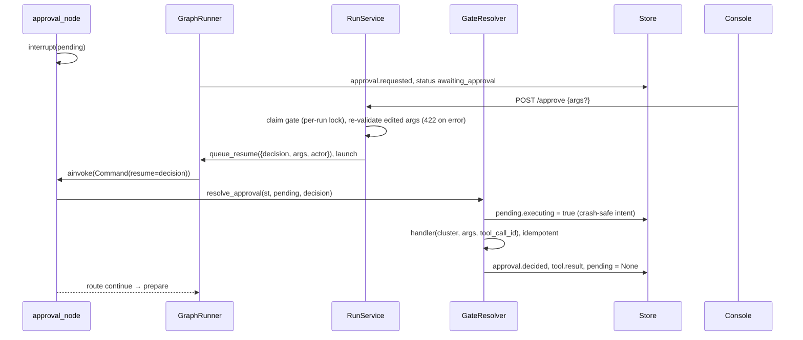
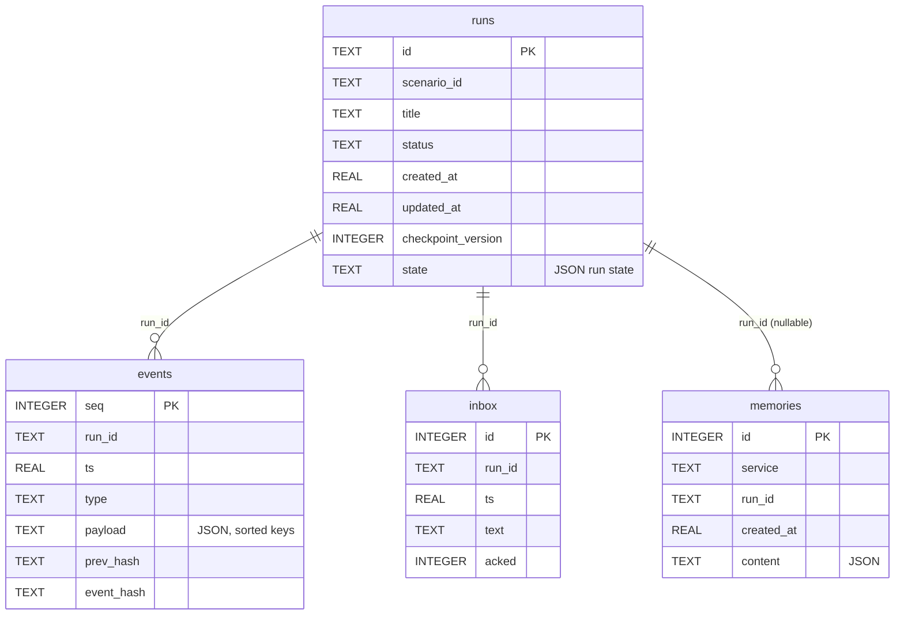

# Low-Level Design: Incident Triage Agent

Companion documents: [High-Level Design](HLD.md) · [Architecture decisions](adr/README.md) · [Architecture review guide](ARCHITECTURE_REVIEW.md) · [Documentation methods](DOC_METHODS.md)

This document is C4 level 3 (components) and level 4 (code) for the agent
core. Line anchors such as `#L52` match the current `main`. If code moves, the
file path and symbol name are the stable reference.

Contents: 1 Project structure · 2 Layers and the dependency rule · 3 Components
(C4 L3) · 4 Key types · 5 LangGraph graph · 6 Run lifecycle · 7 Sequences ·
8 Data model · 9 Events and the hash chain · 10 HTTP API · 11 Tool registry ·
12 Frontend · 13 Design patterns · 14 SOLID · 15 Errors and retries ·
16 Configuration · 17 Testing

## 1. Project structure

```text
app/
  domain/                 Pure Python. Imports only the standard library and app.domain.
    ports.py              LLMPort, ClusterPort; role ports RunRepository, EventLog,
                          OperatorInbox, IncidentMemory, StoreHealth; RunStorePort = all five
    policy.py             risk_for_kind, evaluate_write_confidence
    budget.py             budget_crossings, exhausted_budget
    guards.py             LoopGuard, find_injection_markers
    lifecycle.py          TERMINAL, RESUMABLE, NUDGE
    llm.py, errors.py     ToolCall, LLMResponse, LLMError, ToolError and their transient variants
    memory.py, labels.py  what may be remembered; status and severity wording
  application/            Use cases. Depends on domain ports, never on adapters or FastAPI.
    ports.py              AgentStepsPort, TelemetryPort, NullTelemetry, ToolPresenter, DispatchResult
    run_service.py        RunService: commands (create, approve, reject, pause, resume, cancel, ...)
    run_queries.py        RunQueries: reads (get, list, events, verify, health)
    graph_runner.py       GraphRunner: asyncio tasks that drive the graph, resume queue
    agent_steps.py        AgentSteps: the facade the graph nodes call
    tool_dispatch.py      ToolCallDispatcher: handler registry for one model turn's tool calls
    gate_resolver.py      GateResolver: applies an approval / rejection / answer
    write_gate.py         WriteGate: argument, scope and confidence checks before a gate
    llm_gateway.py        LLMGateway: retries, usage accounting, llm.call event, telemetry
    tool_executor.py      ToolExecutor: read-tool timeouts and retries, result recording
    events.py             RunEventRecorder: append events, persist status transitions
    run_controls.py       RunControls (pause/cancel flags), GateLocks
    working_memory.py     apply_working_memory
    exceptions.py         NotFound, RunStateError, InvalidInput, TooBusy, ConcurrencyConflict
    agent/                graph.py, state.py, deps.py, nodes/{prepare,act,gates}.py
    tools/specs.py        ToolSpec, TOOLS, typed argument models, JSON schemas
    context/builder.py    system prompt, working-memory sections, transcript compaction
  infrastructure/         Adapters behind the ports
    persistence/          store.py (Store), checkpointer.py, db/ (SQLAlchemy models + Alembic)
    cluster/              mock_cluster.py (MockCluster), runbooks.py, factory.py (cluster_for_run)
    llm/                  http.py, gemini.py, anthropic.py, openai.py, fallback.py, scripted.py,
                          factory.py (PROVIDERS registry, make_llm)
    observability/        telemetry.py (PrometheusOtelTelemetry), metrics, tracing, logging, Langfuse
  presentation/
    http/                 app.py (create_http_app), routes.py, dependencies.py, schemas.py,
                          errors.py, middleware.py
    views/                run_view.py, report.py, decisions.py, events.py (EVENT_VIEWS),
                          display.py, tool_labels.py
  core/
    config.py             Settings (pydantic-settings), ConfigError
    container.py          Composition root: build_run_service, Container, build_container
  main.py                 Entrypoint: create_app(), app
frontend/src/
  app/                    App shell, header, ConsolePage, RunSidebar (composes features)
  features/run/           api/ (queries, useStartRun, useRunActions), hooks/ (useActiveRun,
                          useRunStream), components/ (timeline, side panel, report, controls)
  features/approval/      components/ (ApprovalCard, ApprovalEditFields, ApprovalDecision),
                          hooks/useApprovalForm
  components/             ui/ primitives, common/ (DataView, ErrorBoundary, Skeletons, ...)
  hooks/, lib/, stores/, types/, testing/
tests/                    pytest suites, including test_architecture.py
evals/                    scenario evaluation harness
scripts/                  quickstart, Playwright E2E, screenshots, live checks
docs/adr/                 architecture decision records
.claude/skills/           project-local skills with provenance
```

## 2. Layers and the dependency rule



Rules enforced by [`tests/test_architecture.py`](../tests/test_architecture.py):

| Rule | Test |
| --- | --- |
| Every backend module lives in `domain`, `application`, `infrastructure`, `presentation` or `core` (plus `main.py`) | [`test_every_backend_module_lives_in_a_named_layer`](../tests/test_architecture.py#L84) |
| `domain` imports only the standard library and `app.domain` | [`test_domain_is_pure_python`](../tests/test_architecture.py#L91) |
| `application` never imports infrastructure, presentation, the container, FastAPI, SQL drivers, httpx, prometheus_client, OpenTelemetry, structlog or Langfuse | [`test_application_depends_on_ports_not_adapters`](../tests/test_architecture.py#L122) |
| Graph nodes import only the step port | [`test_graph_nodes_see_only_the_step_port`](../tests/test_architecture.py#L128) |
| `infrastructure` never imports presentation or the container | [`test_infrastructure_does_not_depend_on_presentation_or_core_wiring`](../tests/test_architecture.py#L140) |
| `presentation` never imports infrastructure or the container | [`test_presentation_uses_application_not_adapters`](../tests/test_architecture.py#L146) |
| `core.config` imports nothing from `app` | [`test_config_is_a_leaf`](../tests/test_architecture.py#L152) |
| No function-local `app.*` imports (hidden dependencies) | [`test_no_function_local_imports_of_app_modules`](../tests/test_architecture.py#L156) |
| `main.py` defines no routes | [`test_entrypoint_defines_no_routes`](../tests/test_architecture.py#L167) |
| Files ≤ 300 lines, functions ≤ 60, classes ≤ 250 (`scripted.py` exempt) | [`test_modules_functions_and_classes_stay_small`](../tests/test_architecture.py#L193) |

## 3. Components (C4 level 3)



| Component | One responsibility | File |
| --- | --- | --- |
| `RunService` | Validate and apply operator commands | [`run_service.py`](../app/application/run_service.py#L32) |
| `RunQueries` | Read models for the API | [`run_queries.py`](../app/application/run_queries.py#L11) |
| `GraphRunner` | Own the asyncio task per run; drive the graph to the next interrupt or the end | [`graph_runner.py`](../app/application/graph_runner.py#L30) |
| `AgentSteps` | The operations a node may perform during a step | [`agent_steps.py`](../app/application/agent_steps.py#L28) |
| `ToolCallDispatcher` | Route a turn's tool calls through registered handlers | [`tool_dispatch.py`](../app/application/tool_dispatch.py#L47) |
| `WriteGate` | Decide whether a proposal may become a pending gate | [`write_gate.py`](../app/application/write_gate.py#L19) |
| `GateResolver` | Apply the operator's decision once the graph resumes | [`gate_resolver.py`](../app/application/gate_resolver.py#L28) |
| `LLMGateway` | Make a model call robust and measured | [`llm_gateway.py`](../app/application/llm_gateway.py#L18) |
| `ToolExecutor` | Run read tools with timeouts and retries; record results | [`tool_executor.py`](../app/application/tool_executor.py#L26) |
| `RunEventRecorder` | Append events and persist status changes | [`events.py`](../app/application/events.py#L14) |
| `Store` | SQLite persistence for all five store roles | [`store.py`](../app/infrastructure/persistence/store.py#L62) |
| Composition root | Build the object graph with concrete adapters | [`container.py`](../app/core/container.py#L92) |

## 4. Key types



## 5. LangGraph graph

Built in [`graph.py`](../app/application/agent/graph.py). The run id is the
thread id; `GraphRunner` passes the step port as `configurable.steps`, and
[`steps_from`](../app/application/agent/deps.py#L10) reads it back.


Each node is a few lines that call the step port. The act node in full
([`act.py`](../app/application/agent/nodes/act.py#L12)):

```python
async def act_node(state: dict, config: RunnableConfig) -> dict[str, Any]:
    steps = steps_from(config)
    st = steps.load(state["run_id"])
    st["step"] += 1
    step = st["step"]
    acks = steps.drain_inbox(st, step)
    st["inbox_acks"] = acks

    resp = await steps.call_llm(st, steps.build_messages(st))
    steps.record_assistant(st, resp, step)
    if resp.tool_calls:
        route = steps.conclude(st, await steps.dispatch(st, resp.tool_calls, step))
    else:
        route = steps.nudge(st, step)

    st["route"] = route
    if route != "stop":
        steps.save(st)  # stop paths were already persisted by their status change
    steps.ack_inbox(acks)  # at-least-once: ack only after the messages are in a saved checkpoint
    return st
```

| Node | Responsibility |
| --- | --- |
| [`prepare_node`](../app/application/agent/nodes/prepare.py#L12) | Take the pause/cancel flag, enforce budgets, set `running`, emit budget alerts |
| [`act_node`](../app/application/agent/nodes/act.py#L12) | Drain the inbox, call the model, dispatch tools, choose the route |
| [`approval_node`](../app/application/agent/nodes/gates.py#L18) | `interrupt(pending)`; on resume apply or reject through `GateResolver` |
| [`input_node`](../app/application/agent/nodes/gates.py#L32) | `interrupt(pending)` for `ask_operator`; record the answer |

## 6. Run lifecycle

Statuses change only through `RunEventRecorder.set_status`, which also emits
`run.status`. `TERMINAL = {completed, failed, cancelled}`,
`RESUMABLE = {paused, interrupted, failed, needs_attention}`
([`lifecycle.py`](../app/domain/lifecycle.py)).



`failed` counts as terminal for cancel but is resumable: resume retries from
the last checkpoint.

## 7. Sequences

### 7.1 Start a run and stream events



### 7.2 One step with a write proposal



### 7.3 Approval interrupt and resume



## 8. Data model

The Store creates these tables ([`store.py`](../app/infrastructure/persistence/store.py#L20)).
The SQLAlchemy models in [`db/models.py`](../app/infrastructure/persistence/db/models.py)
mirror them, and an Alembic migration creates the same tables. The migration
creates `events` without `prev_hash`/`event_hash`; the Store adds both columns
on startup when they are missing.



Relationships are logical (by `run_id`); no foreign keys are declared. Index:
`idx_events_run (run_id, seq)`. The LangGraph checkpointer keeps its own tables
in a separate database.

## 9. Events and the hash chain

Each event is `{seq, run_id, ts, type, payload, prev_hash, event_hash}`, and
`payload` always includes `step`. The API adds an `operator` projection next to
the hashed payload, never inside it.

| Type | Emitted when |
| --- | --- |
| `run.created`, `run.status`, `run.finished` | Run created, status changed, report written |
| `memory.recalled`, `memory.update`, `memory.saved` | Past incidents recalled, working memory updated, resolved incident remembered |
| `llm.call`, `gen_ai.span`, `llm.retry`, `agent.message` | Model call metrics, span attributes, retry, model text |
| `tool.call`, `tool.result`, `tool.retry` | Tool dispatched, result recorded, transient retry |
| `approval.requested`, `approval.decided`, `input.requested` | Human gates |
| `operator.control`, `operator.message` | Pause/resume/cancel, operator messages |
| `policy.blocked`, `security.injection_flagged`, `budget.alert`, `context.compacted` | Governance and context signals |

`event_hash = sha256(f"{prev_hash}|{run_id}|{ts:.6f}|{type}|{payload_json}")`
with `payload_json = json.dumps(payload, sort_keys=True, default=str)` and
`prev_hash = ""` for a run's first event. `verify_event_chain` walks a run's
events in `seq` order and returns `{"ok": true, "events": n}` or
`{"ok": false, "seq": n, "reason": ...}`.

## 10. HTTP API

Routes: [`routes.py`](../app/presentation/http/routes.py). Read routes use
`RunQueries`; write routes use `RunService`; both arrive through typed
`Annotated` dependencies in [`dependencies.py`](../app/presentation/http/dependencies.py).
"Auth" means the bearer token is checked when `API_TOKEN` is set.

| Method | Path | Auth | Purpose |
| --- | --- | --- | --- |
| GET | `/` | no | Built React console (or a short API page if `frontend/dist` is missing) |
| GET | `/healthz` | no | Liveness |
| GET | `/readyz` | no | Readiness: Store ping, provider name |
| GET | `/metrics` | no | Prometheus exposition via `TelemetryPort.export` |
| GET | `/api/health` | yes | Provider, model, limits, whether auth is on |
| GET | `/api/scenarios` | yes | Scenario cards |
| GET | `/api/tools` | yes | Tool schemas |
| POST | `/api/runs` | yes | Create a run (`201`; `404` unknown scenario; `429` too busy) |
| GET | `/api/runs` | yes | Recent runs |
| GET | `/api/runs/{run_id}` | yes | Run view; `?include_history=true` adds the transcript |
| GET | `/api/runs/{run_id}/context` | yes | Prompt the model would see next |
| GET | `/api/runs/{run_id}/events` | yes | Events after `?after=` with operator projections |
| GET | `/api/runs/{run_id}/stream` | yes (`?token=` allowed) | SSE; resumes from `Last-Event-ID` |
| GET | `/api/runs/{run_id}/events/verify` | yes | Recompute the hash chain |
| POST | `/api/runs/{run_id}/approve` | yes | Approve, optionally with edited `args` |
| POST | `/api/runs/{run_id}/reject` | yes | Reject with optional `feedback` |
| POST | `/api/runs/{run_id}/message` | yes | Message the agent or answer its question |
| POST | `/api/runs/{run_id}/pause` | yes | Pause at the next step boundary |
| POST | `/api/runs/{run_id}/resume` | yes | Resume a resumable run |
| POST | `/api/runs/{run_id}/cancel` | yes | Cancel |
| POST | `/api/emergency-stop` | yes | Cancel every non-terminal run |

Errors map through one table, [`STATUS_BY_ERROR`](../app/presentation/http/errors.py#L11):
`NotFound` 404, `RunStateError` 409, `ConcurrencyConflict` 409, `InvalidInput`
422, `TooBusy` 429. Bodies are `{"detail": ..., "operator": {...}}`.

## 11. Tool registry

Defined in [`specs.py`](../app/application/tools/specs.py). Risk comes from
`risk_for_kind`: `write` → `high`, otherwise `low`. Every tool must have a
dispatch handler ([`test_every_tool_has_a_dispatch_handler`](../tests/test_architecture.py#L243)).

| Tool | Kind | Dispatch handler | Arguments |
| --- | --- | --- | --- |
| `get_alert`, `list_services` | read | `read` (parallel) | none |
| `describe_service`, `get_recent_deploys` | read | `read` | `service` |
| `query_metrics` | read | `read` | `service`, `metric`, `window_minutes` (5–360) |
| `search_logs` | read | `read` | `service`, `query`, `limit` (1–500) |
| `search_runbooks` | read | `read` | `query`, `top_k` (1–3) |
| `rollback_deploy` | write | `write` → `WriteGate` | `service`, `to_version`, `reason`, `confidence` |
| `restart_service` | write | `write` → `WriteGate` | `service`, `reason`, `confidence` |
| `update_working_memory` | meta | `update_working_memory` | `plan`, `hypotheses`, `note` |
| `ask_operator` | meta | `ask_operator` → `WriteGate` | `question` |
| `finish` | meta | `finish` | `summary`, `root_cause`, `resolved`, `fix_applied`, `follow_ups` |

## 12. Frontend

The layout follows bulletproof-react: `app` composes `features`, features never
import each other, and shared code (`components`, `hooks`, `lib`, `stores`,
`types`) imports neither. There are no barrel files. These rules and a
200-line component limit are tested in
[`architecture.test.ts`](../frontend/src/testing/architecture.test.ts).

| Concern | Implementation |
| --- | --- |
| Routing | `HashRouter`: `/` and `/runs/:runId` → `ConsolePage` |
| Composition | [`RunSidebar`](../frontend/src/app/routes/RunSidebar.tsx) builds one `useRunActions` and passes it to `ApprovalCard` and `SidePanel`, so the two features stay independent |
| Server state | TanStack Query; keys in [`queryKeys.ts`](../frontend/src/lib/queryKeys.ts#L2) |
| Actions | [`useRunActions`](../frontend/src/features/run/api/useRunActions.ts#L10): approve, reject, message, pause, resume, cancel with error toasts |
| Streaming | [`useRunStream`](../frontend/src/features/run/hooks/useRunStream.ts#L76): `EventSource`, de-duplication by `seq`, reconnect with backoff, pure [`streamReducer`](../frontend/src/features/run/hooks/useRunStream.ts#L22) |
| Approval form | [`useApprovalForm`](../frontend/src/features/approval/hooks/useApprovalForm.ts#L25) holds the draft, feedback, submit state and A/R shortcuts scoped to the card; the card renders `ApprovalEditFields` and `ApprovalDecision` |
| Client state | Zustand [`uiStore.ts`](../frontend/src/stores/uiStore.ts): operator name, theme, SSE status, thinking phase, engineer-details toggle |
| Display | Components render the API's `operator` projections; raw data appears only under "For engineers" |

## 13. Design patterns

Only patterns present in the code are listed, each with the code that shows it.

| Pattern | Where | Why here |
| --- | --- | --- |
| Ports and adapters | Ports in [`domain/ports.py`](../app/domain/ports.py#L19); adapters in `app/infrastructure` | Storage, platform and model can change without touching use cases |
| Composition root | [`build_run_service`](../app/core/container.py#L92), [`build_container`](../app/core/container.py#L171) | One place knows concrete classes; tests and evals use the same wiring |
| Strategy | `LLMPort` implemented by [`GeminiLLM`](../app/infrastructure/llm/gemini.py#L86), [`AnthropicLLM`](../app/infrastructure/llm/anthropic.py#L48), [`OpenAILLM`](../app/infrastructure/llm/openai.py#L35), [`ScriptedPolicy`](../app/infrastructure/llm/scripted.py#L76) | Live and offline models are interchangeable |
| Registry (provider) | [`PROVIDERS`](../app/infrastructure/llm/factory.py#L61) + [`make_llm`](../app/infrastructure/llm/factory.py#L88) | New provider = one builder and one entry |
| Registry (tool dispatch) | [`ToolCallDispatcher.register`](../app/application/tool_dispatch.py#L78) | Replaces the old if/elif chain in `act_node` |
| Registry (event views) | [`EVENT_VIEWS`](../app/presentation/views/events.py#L95) | New operator-visible event = one entry |
| Registry (prompt sections) | [`WORKING_MEMORY_SECTIONS`](../app/application/context/builder.py#L154) | New working-memory section = one function |
| Decorator | [`LLMGateway`](../app/application/llm_gateway.py#L18) (retries, accounting), [`GeminiWithFallback`](../app/infrastructure/llm/fallback.py#L13) (quota fallback) | Adds behaviour without changing the wrapped adapter |
| Facade | [`AgentSteps`](../app/application/agent_steps.py#L28) for nodes; [`RunService`](../app/application/run_service.py#L32) for routes | Callers see one small surface |
| Null Object | [`NullTelemetry`](../app/application/ports.py#L73) | Tests and evals need no metrics backend and no `if telemetry:` checks |
| Template method | [`GraphRunner`](../app/application/graph_runner.py#L30) drive loop: invoke, publish gate, map exceptions to statuses | Same lifecycle handling for every run |
| Observer | [`RunEventRecorder.emit`](../app/application/events.py#L25) → event log → SSE route → `EventSource` | Producers are decoupled from the UI; replay by `Last-Event-ID` |
| CQRS-lite | [`RunQueries`](../app/application/run_queries.py#L11) for reads, `RunService` for commands | Read routes cannot mutate state |
| Repository + optimistic locking | [`Store.save`](../app/infrastructure/persistence/store.py#L97) with `checkpoint_version` CAS | Lost updates become HTTP 409 |
| Policy object | [`evaluate_write_confidence`](../app/domain/policy.py#L36), [`exhausted_budget`](../app/domain/budget.py#L33) | Pure, unit-testable governance rules |
| State machine | Section 6 statuses; LangGraph `StateGraph` with `interrupt()` | Explicit transitions and durable human gates |
| Reducer / custom hooks (frontend) | `streamReducer`, `useRunActions`, `useApprovalForm` | Side effects stay out of components |

### 13.1 Registry: tool dispatch

[`tool_dispatch.py`](../app/application/tool_dispatch.py#L72)

```python
        self._handlers: dict[str, ToolHandler] = {}
        self.register("read", self._queue_read)
        self.register("write", self._open_gate)
        self.register("ask_operator", self._open_gate)
        self.register("update_working_memory", self._update_memory)
        self.register("finish", self._queue_finish)

    def register(self, key: str, handler: ToolHandler) -> None:
        """Bind a handler to a tool name or a tool kind."""
        self._handlers[key] = handler
```

### 13.2 Registry + Strategy: LLM providers

[`factory.py`](../app/infrastructure/llm/factory.py#L61)

```python
PROVIDERS: dict[str, ProviderBuilder] = {
    "gemini": _build_gemini,
    "anthropic": _build_anthropic,
    "openai": _build_openai,
    "scripted": _build_scripted,
}
```

### 13.3 Decorator: quota fallback

[`fallback.py`](../app/infrastructure/llm/fallback.py#L40)

```python
    async def complete(self, system, messages, tools, state=None) -> LLMResponse:
        try:
            return await self._active.complete(system, messages, tools, state)
        except LLMTransientError as e:
            if self._fallback is not None and not self._switched \
                    and self._active is self._primary and self._is_quota(e):
                self._active = self._fallback
                self._switched = True
                return await self._active.complete(system, messages, tools, state)
            raise
```

(Shortened: the log line is omitted and the signature is condensed.)

### 13.4 Null Object: telemetry

[`ports.py`](../app/application/ports.py#L73)

```python
class NullTelemetry:
    """Null Object for ``TelemetryPort``: records nothing."""

    @contextmanager
    def span(self, name: str, **attrs: Any) -> Iterator[dict[str, Any]]:
        yield dict(attrs)

    def tool_call(self, tool: str, is_error: bool) -> None:
        return None
```

(Shortened: `llm_call`, `approval` and `export` follow the same shape.)

### 13.5 Composition root

[`container.py`](../app/core/container.py#L92)

```python
def build_run_service(store, llm, settings, *, telemetry=None) -> RunService:
    telemetry = telemetry or PrometheusOtelTelemetry()
    events = RunEventRecorder(store, store)
    controls = RunControls()
    steps = _build_agent_steps(store, llm, settings, events, controls, telemetry)
    runner = GraphRunner(runs=store, events=events, steps=steps, controls=controls,
                         settings=settings, checkpointer_factory=open_checkpointer,
                         present_pending=enrich_pending)
    queries = RunQueries(store=store, llm=llm, runner=runner,
                         scenario_loader=load_scenario, scenario_catalog=list_scenarios)
    return RunService(store=store, settings=settings, events=events, runner=runner,
                      steps=steps, controls=controls, tools=TOOLS, queries=queries,
                      scenario_loader=load_scenario)
```

(Type annotations removed for width.)

## 14. SOLID

| Principle | Where it shows | Guarded by |
| --- | --- | --- |
| Single responsibility | The former 552-line `RunService` is now `RunService` (commands), `RunQueries` (reads), `GraphRunner` (task lifecycle), `AgentSteps` (step facade), `ToolCallDispatcher`, `GateResolver`, `WriteGate`, `LLMGateway`, `ToolExecutor`, `RunEventRecorder`. Routes only translate HTTP. | Size budgets in `test_modules_functions_and_classes_stay_small`; `test_entrypoint_defines_no_routes` |
| Open/closed | New provider = `PROVIDERS` entry; new tool of an existing kind = `ToolSpec` only; new operator event = `EVENT_VIEWS` entry; new prompt section = `WORKING_MEMORY_SECTIONS` entry; new error = `STATUS_BY_ERROR` row | `test_provider_registry_covers_every_configurable_provider`, `test_every_tool_has_a_dispatch_handler` |
| Liskov substitution | Every LLM adapter, `GeminiWithFallback`, test fakes and `NullTelemetry` are used only through their Protocols | `test_adapters_implement_ports`, `test_quota_error_switches_to_fallback_model` |
| Interface segregation | `RunStorePort` is five role Protocols; `RunEventRecorder` takes only `EventLog` and `RunRepository`; nodes see only `AgentStepsPort` | `test_graph_nodes_see_only_the_step_port`, `test_agent_steps_satisfies_the_step_port` |
| Dependency inversion | Application classes take ports in their constructors; only `core/container.py` names concrete classes; metrics go through `TelemetryPort` | `test_application_depends_on_ports_not_adapters` |

Interface segregation in code ([`ports.py`](../app/domain/ports.py#L126)):

```python
@runtime_checkable
class RunStorePort(RunRepository, EventLog, OperatorInbox, IncidentMemory, StoreHealth, Protocol):
    """Everything the SQLite ``Store`` offers. Collaborators depend on the narrow roles above."""
```

```python
class RunEventRecorder:
    def __init__(self, events: EventLog, runs: RunRepository) -> None:
        self._events = events
        self._runs = runs
```

## 15. Errors and retries

| Where | Policy |
| --- | --- |
| `ToolExecutor.execute_read` | `asyncio.wait_for(TOOL_TIMEOUT_S)`; `ToolTransientError` or timeout retried up to `TOOL_MAX_ATTEMPTS` with `TOOL_BACKOFF_S * 2^(n-1)`; `ToolError` returned to the model |
| `LLMGateway.complete` | Tenacity: `LLM_MAX_ATTEMPTS`, jittered exponential backoff between `LLM_BACKOFF_S` and `LLM_MAX_BACKOFF_S`, honours `retry_after_s` |
| `GeminiWithFallback` | On quota or 429 switches to `GEMINI_FALLBACK_MODEL` for the rest of the process |
| `GraphRunner` drive loop | Unhandled exception → `failed`; operator cancel → `cancelled`; process shutdown → `interrupted` |
| `Store.save` | CAS on `checkpoint_version`, one rebase retry, then `CheckpointConflict` (409) |
| `RunService.approve` | Per-run gate lock makes a double click a no-op; invalid edits → 422 before the graph runs |
| Frontend | `mapError` turns API errors into operator copy; `ErrorBoundary`; SSE reconnect banner |

## 16. Configuration

All settings are fields of `Settings` ([`config.py`](../app/core/config.py#L42)),
overridable by upper-case environment variables or `.env`. Provider keys
(`GEMINI_API_KEY` or `GOOGLE_API_KEY`, `ANTHROPIC_API_KEY`, `OPENAI_API_KEY`)
are read from the environment by the provider builders. [`.env.example`](../.env.example)
lists them with empty values.

| Group | Variables (default) |
| --- | --- |
| Model | `LLM_PROVIDER` (auto), `GEMINI_MODEL`, `GEMINI_FALLBACK_MODEL`, `ANTHROPIC_MODEL`, `OPENAI_MODEL`, `REQUIRE_LLM` (false), `LLM_TIMEOUT_S` (120), `LLM_MAX_ATTEMPTS` (4), `LLM_BACKOFF_S` (1), `LLM_MAX_BACKOFF_S` (60), `LLM_MAX_OUTPUT_TOKENS` (8192), `SCRIPTED_DELAY_S` (0.8) |
| Budgets and policy | `MAX_STEPS` (25), `MAX_RUN_TOKENS` (400000), `MAX_RUN_COST_USD` (1.0), `MIN_WRITE_CONFIDENCE` (0.5), `MAX_CONCURRENT_RUNS` (10), `MAX_IDENTICAL_TOOL_CALLS` (3), `BUDGET_ALERT_RATIO` (0.8), `BUDGET_HARD_STOP` (false) |
| Context | `CONTEXT_BUDGET_TOKENS` (24000), `TOOL_OUTPUT_MAX_CHARS` (6000), `KEEP_RECENT_GROUPS` (6), `MEMORY_TTL_DAYS` (30) |
| Tools | `TOOL_MAX_ATTEMPTS` (3), `TOOL_BACKOFF_S` (0.5), `TOOL_TIMEOUT_S` (10) |
| Cost estimate | `COST_IN_PER_MTOK` (0.5), `COST_OUT_PER_MTOK` (3.0) |
| Security | `API_TOKEN` (empty = no auth), `CORS_ORIGINS`, `MAX_REQUEST_BYTES` (1048576) |
| Persistence | `DB_PATH` (data/agent.db), `DATABASE_URL`, `CHECKPOINT_DB_PATH` |
| Observability | `LOG_FORMAT` (text), `LOG_LEVEL` (INFO), `OTLP_ENDPOINT`, `LANGFUSE_PUBLIC_KEY`, `LANGFUSE_SECRET_KEY`, `LANGFUSE_HOST` |

Invalid values raise `ConfigError` at startup.

## 17. Testing

| Concern | Tests |
| --- | --- |
| Layer rules, size budgets, port conformance, registries | [`tests/test_architecture.py`](../tests/test_architecture.py) |
| Agent loop, approval, rejection, edit, crash resume, pause, budgets, compaction, memory, HTTP round trip | [`tests/test_agent.py`](../tests/test_agent.py) |
| LangGraph topology and interrupt/resume | [`tests/test_langgraph.py`](../tests/test_langgraph.py) |
| Hash chain, risk labels, scope block, hard budget stop, emergency stop | [`tests/test_governance.py`](../tests/test_governance.py) |
| Injection markers, loop guard, runbooks, budget alerts, GenAI spans | [`tests/test_hardening.py`](../tests/test_hardening.py) |
| Auth, security headers, input limits, 429, graceful shutdown | [`tests/test_production.py`](../tests/test_production.py) |
| Operator projections; reload and SSE agree | [`tests/test_display.py`](../tests/test_display.py) |
| Gemini adapter against a mocked API | [`tests/test_gemini.py`](../tests/test_gemini.py) |
| Live Gemini smoke (opt-in, `-m live`) | [`tests/test_e2e_live.py`](../tests/test_e2e_live.py) |
| Scenario outcomes | [`evals/run_evals.py`](../evals/run_evals.py) |
| Frontend units and boundaries (Vitest) | `*.test.ts(x)` under [`frontend/src`](../frontend/src) |
| Browser end to end (Playwright) | [`scripts/e2e_ui.py`](../scripts/e2e_ui.py) |
