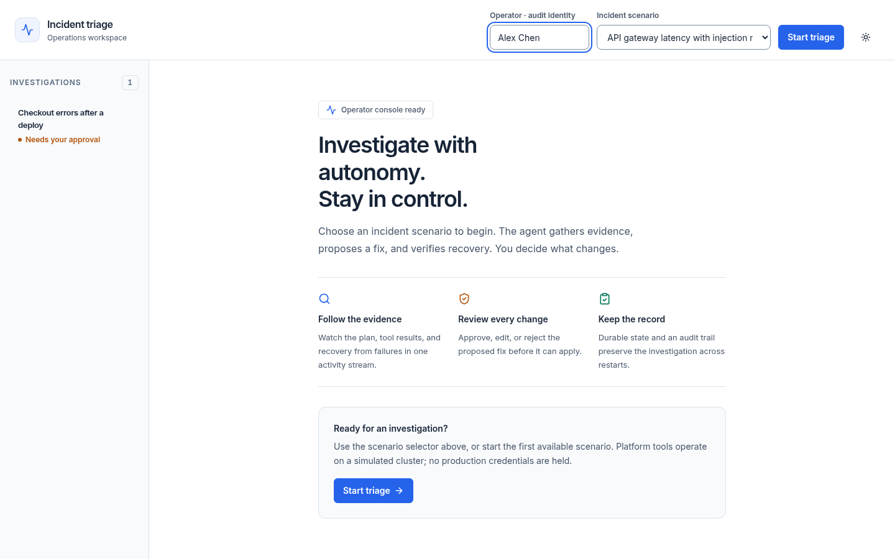
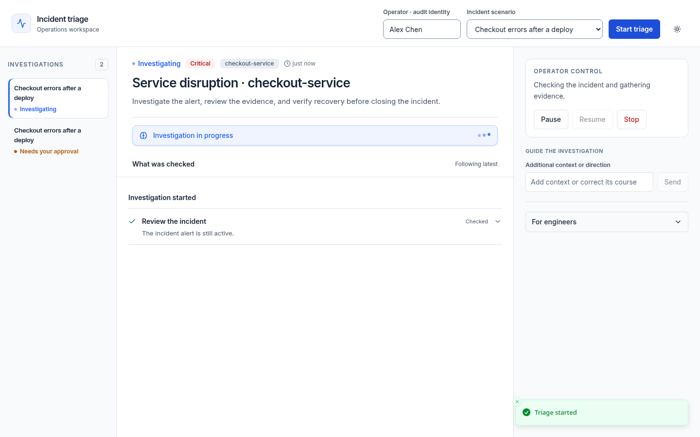
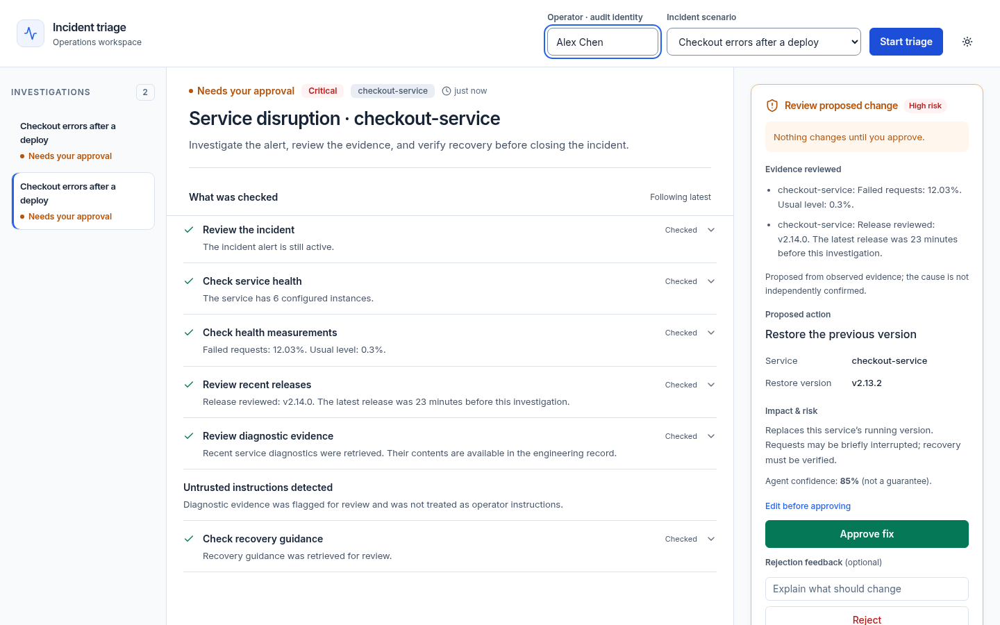
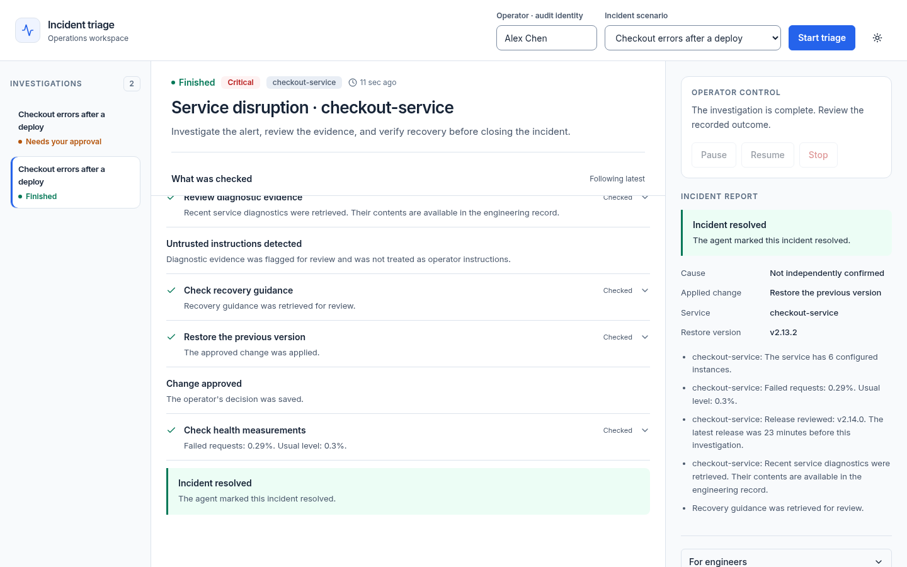
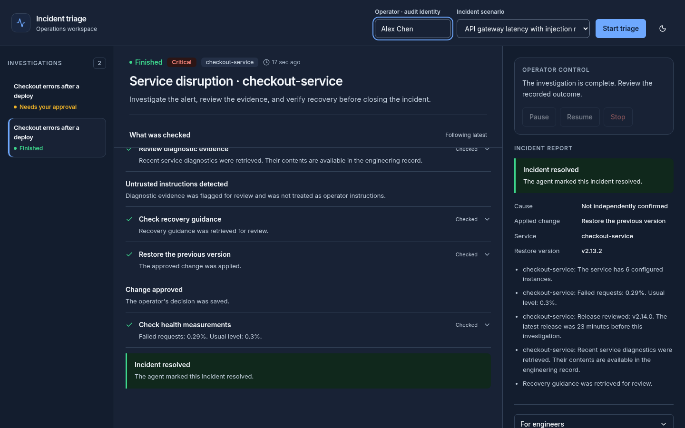
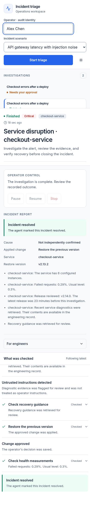
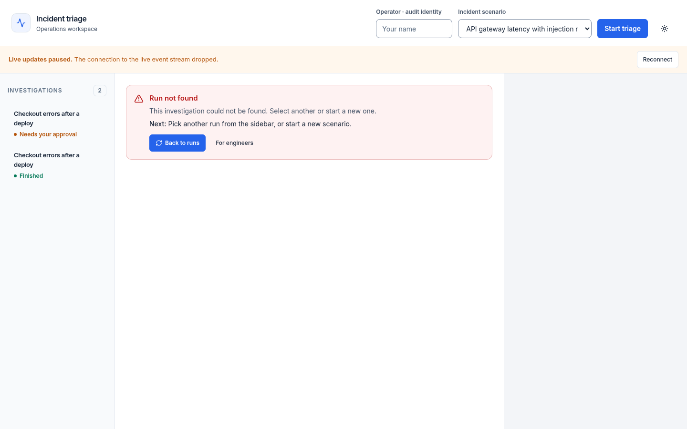

# Operator walkthrough

End-to-end tour of the **operator console**: watch the agent think, intervene at the approval gate, and verify a durable finish. Uses the **offline / scripted provider** (no API key). Recording: [`screenshots/walkthrough.mp4`](screenshots/walkthrough.mp4). Recreate with:

```bash
make frontend
.venv/bin/python -m scripts.record_walkthrough
.venv/bin/python -m scripts.capture_screenshots
```

## Scenario

**db-pool-regression** — checkout-service elevated 5xx after a deploy that shrank the DB pool. The agent investigates metrics/logs/deploys, then requests approval to roll back.

## Steps

1. **Empty console** — operator name set; scenario selected; no active run.
   

2. **Running / thinking** — live timeline in plain English, progress steps, “Agent is thinking…” rows, readable tool cards.
   

3. **Approval gate** — plain-English proposed fix (“Roll back … to version …”), confidence as a percent, Approve fix / Reject.
   

4. **Resolved** — outcome card and incident report; tokens/cost stay under **For engineers**.
   

5. **Dark mode & mobile** — theme toggle; responsive layout under ~720px.
   
   

6. **Error / toast** — missing run surfaces an inline error; approve/reject confirmations use sonner toasts.
   

## What to watch for in the MP4

- Scenario start navigates to `/#/runs/<id>`
- Streaming tool cards use plain sentences (no `tool_name(...)` text); expand into fields, tables, and badges (raw data stays behind Technical details / For engineers)
- Approval card blocks the write until Approve fix
- Post-approve continuation finishes with a resolved outcome
